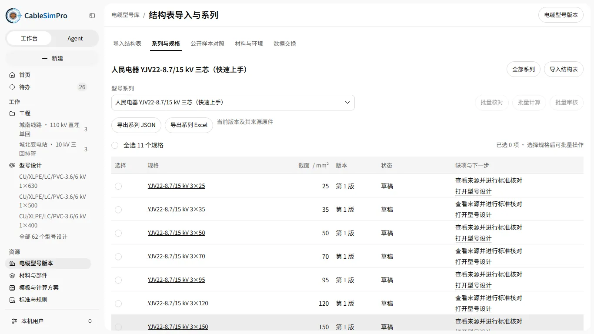

# CableSimPro

电缆行业的设计与计算平台：在同一份可追溯的工程数据上完成**电缆型号设计、载流量计算、仿真复核和正式交付文件**。计算方法全部以插件提供，宿主只负责工程、版本、运行快照、来源追溯、审批与交付；每个结果都能追溯到输入、方法和版本。


- **产品文档**：[`site/`](site/) 是中文文档网站（Astro Starlight），含下载安装、两条快速上手、各模块用法、计算方法与插件开发；`npm --prefix site ci` 后用 `npm --prefix site run dev` 本地预览
- 产品需求：[docs/product/PRD.md](docs/product/PRD.md) · 系统架构：[docs/design/SYSTEM_ARCHITECTURE.md](docs/design/SYSTEM_ARCHITECTURE.md) · 计算方法：[docs/METHOD.md](docs/METHOD.md)
- 开发约定与仓库卫生规则：[AGENTS.md](AGENTS.md)

## 能做什么

| 模块 | 内容 |
| --- | --- |
| 型号库与型号设计 | 导入厂家结构表（CSV/XLSX）；按分层截面编辑结构、尺寸与用料；按 GB/T 12706、GB/T 3956 核对结构尺寸和导体电阻；计算电气参数与短路容量；审核、发布型号版本并生成规格书 |
| 载流量计算 | IEC 60287 稳态载流量与运行温度研究，参数扫描，候选型号选型，交叉热源降额，GB 50217 校正，型号载流量表 |
| 仿真复核 | 有限元稳态、暂态与电热耦合，提交到超算执行（本机不运行原生求解器），与 IEC 结果对照 |
| Agent 助手 | 在对话中查询、计算、导入厂家表、生成计算书与规格书；所有写操作都是提案，必须由人在对话中接受 |
| 正式交付 | 计算书、规格书、载流量表（PDF 与 Excel），四签栏，逐值追溯页，显示修约按 GB/T 8170 |
| 工程底座 | 工程版本与撤销、不可变运行快照、来源追溯、数据库备份恢复；12 个插件全部封签校验 |

| | |
| --- | --- |
|  |  |
| 型号设计：分层截面、分层表与型号名片 | 载流量研究：敷设截面、工况与允许电流 |
|  |  |
| Agent：读取保存的研究结论并给出结果卡片 | 型号库：厂家结构表导入后的系列与规格 |

## 快速开始

需要 **Python 3.11+、Node.js 22.12+（含 npm）和 Git**，首次启动需要联网安装依赖。在仓库根目录执行：

```powershell
python scripts/run_demo.py
```

启动器会准备 CAD 资产、独立 Python 环境和正式前端，首次启动时用教学输入生成演示工程库，然后打开 <http://127.0.0.1:8100/>。工程数据保存在 `.data/release/engineering.sqlite`，以后启动沿用已有数据；按 `Ctrl+C` 退出。

- **Agent 对话**：一键演示会同时启动 Agent 边车（需要 Node.js 22.12+）。模型在“设置 · AI 模型”中配置，密钥只从环境变量或系统凭据读取，不写入文件，见文档 [接入模型](site/src/content/docs/install/model.md)。
- **离线安装包**：`scripts/build_release.py` 生成 Windows/Linux 离线包，自带 Python 和固定版本的 Node.js 与 Agent 边车，安装后不需要联网；安装、升级和配置见文档 [下载与安装](site/src/content/docs/install/index.mdx)。
- **备份恢复**：`scripts/workspace_db.py backup / restore`，步骤见文档 [升级与恢复](site/src/content/docs/install/upgrade-restore.md)。

### 常见问题

| 遇到的情况 | 怎么处理 |
| --- | --- |
| 8100 端口被占用 | 先确认是否已经启动过本程序；否则执行 `python scripts/run_demo.py --port 8101`，改用 <http://127.0.0.1:8101/> |
| 三维视图或规格书提示缺少 `cadquery` | 在启动器创建的环境中安装原生依赖后重启：`.\.data\release\venv\Scripts\python.exe -m pip install -r plugins/requirements-native.txt` |
| 提示插件摘要、封签或依赖不一致（接口返回 409） | 把完整报错交给维护人员核对程序和插件版本；修复前不要改工程参数绕过 |
| 超算未配置或不可用 | 有限元、暂态、电热耦合和批量仿真拿不到新结果；IEC 代数计算、参数扫描、输入编辑、导出和备份照常可用，已保存且校验通过的结果可查看 |

## 插件

| 插件 | 版本 | 作用 |
| --- | --- | --- |
| `cablesim.iec60287` | 1.2.1 | IEC 60287 稳态温度与允许电流：单芯或独立屏蔽三芯，直埋、排管与回填 |
| `cablesim.gb50217-correction` | 1.0.7 | GB 50217 附录 D 载流量校正，系数由标准依据库核验 |
| `cablesim.type-electrical` | 1.2.5 | 型号电气参数与短路容量（IEC 60287、IEC 60949） |
| `cablesim.standard-check` | 1.8.6 | 按 GB 产品标准逐条核对结构尺寸和导体 R₂₀ |
| `cablesim.standards-basis` | 0.9.1 | 离线只读的标准依据库：尺寸、电阻和试验数值及原页出处 |
| `cablesim.cable-geometry` | 1.1.1 | 电缆实体建模：分层截面、外径与理论用料，OCCT 实体与 STEP |
| `cablesim.simulation` | 1.7.2 | 有限元仿真：多区域稳态导热、时谐涡流、稳态/暂态热 |
| `cablesim.native-reference` | 1.0.9 | CAD、网格、有限元、电热与线源参考 |
| `cablesim.hybrid-rating` | 1.1.1 | IEC 基线加有限元热场修正的混合载流量研究（默认仅参考） |
| `cablesim.thermal-network` | 1.0.2 | 简化热网络，用于同输入方法对比 |
| `cablesim.datasheet-extract` | 1.0.2 | 厂家资料参数提取，结果只作为待人工核对的候选 |
| `cablesim.comsol-bridge` | 1.0.4 | 可选：调用用户已安装的 COMSOL 做内部基准比较，平台计算不依赖它 |

插件规范见 [CableSimPro-Plugins/SPEC.md](https://github.com/luohui1/CableSimPro-Plugins/blob/main/SPEC.md) 与 [docs/plugins/](docs/plugins/)；清单位于 `plugins/<id>/plugin.json`，`plugins/registry.json` 是由清单生成的发布索引。

## 工程边界

- 这是工程计算与复核工具，不是经认证的设计系统；正式签审前必须由工程师复核，下载了 PDF 不代表已完成厂内审核或型号发布。
- 每个方法只在其声明的适用范围内计算，超出范围明确拒绝；缺少数据时列出缺项，不用推测值补齐。
- 标准数据只覆盖已逐格核验的条款；未覆盖的条款在核对结果中标为“未覆盖”。
- 有限元、批量仿真等原生计算只提交到超算执行；超算不可用时，这些新结果无法取得，IEC 代数计算、扫描、编辑和导出不受影响。

## 目录

| 目录 | 内容 |
| --- | --- |
| `backend/` | FastAPI 宿主：工程、研究、运行快照、比较与交付（`kernel/`），SI 领域事实（`domain/`），插件执行器（`plugin_host/`），Agent 工具层（`harness/`） |
| `frontend/` | 正式 React 前端与浏览器回归脚本 |
| `studio/` | Agent 对话界面与 Node 边车（pi 内核） |
| `plugins/` | 12 个第一方插件，各自的 `src/` 与 v2 清单 |
| `cablesim_sdk/`、`plugin-spec/` | 插件与宿主共用的契约和 JSON Schema |
| `site/` | 文档网站（Astro Starlight） |
| `docs/` | 需求、架构、插件说明和计算方法 |
| `tests/`、`plugin-tests/` | 后端测试；原生插件测试需要原生环境 |

## 开发与测试

```sh
python -m pip install -r backend/requirements-dev.txt
python -m pytest                    # 后端与仓库卫生检查
npm --prefix frontend test          # 前端单元测试
python scripts/plugin_sdk.py verify # 插件清单与封签
```

CI（`.github/workflows/ci.yml`）在 main 和每个 PR 上运行：卫生与插件目录检查、后端 Python 3.11–3.13、Agent 实测与浏览器走查、Windows/Linux 离线安装验收。原生仿真回归只在超算自托管 runner 上运行。本地中间文件用 `python scripts/clean.py` 清理。

版本号的唯一来源是 `backend/__init__.py`。
