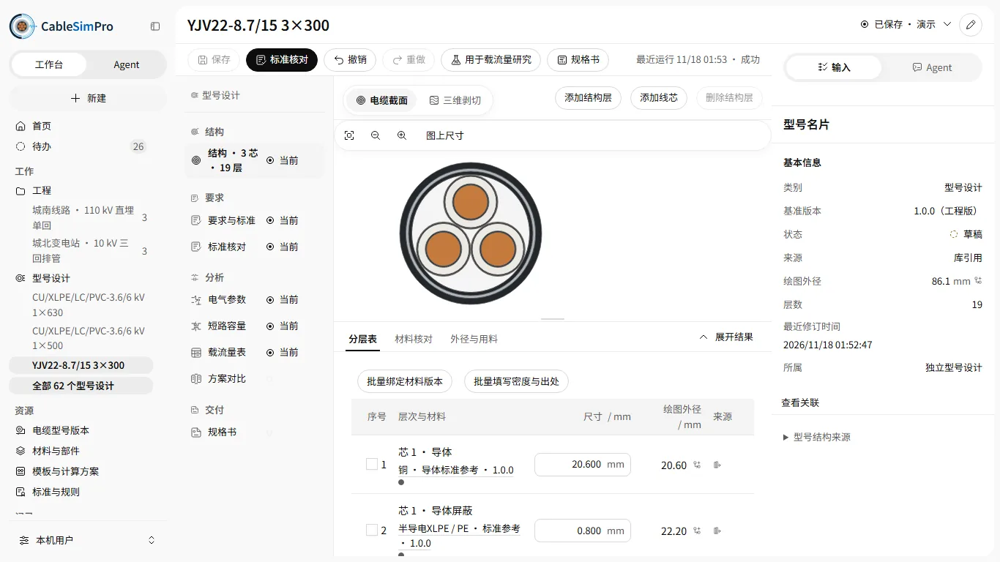
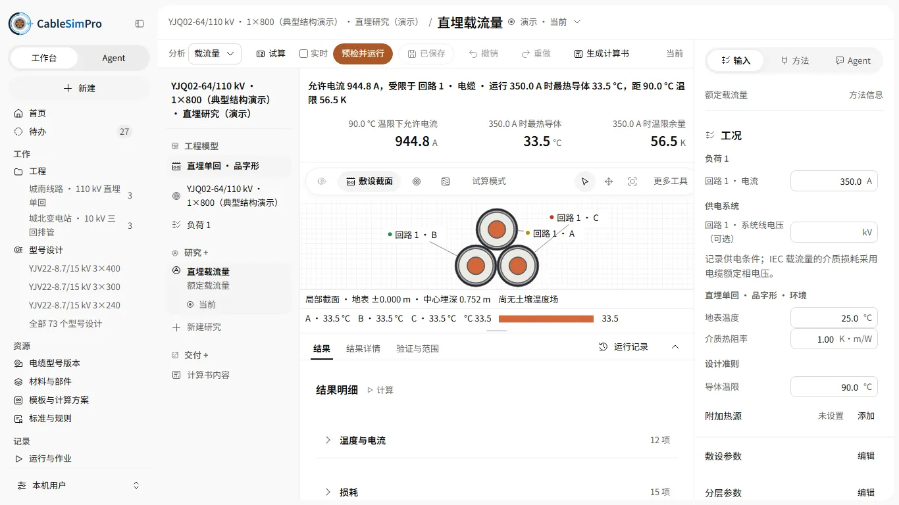
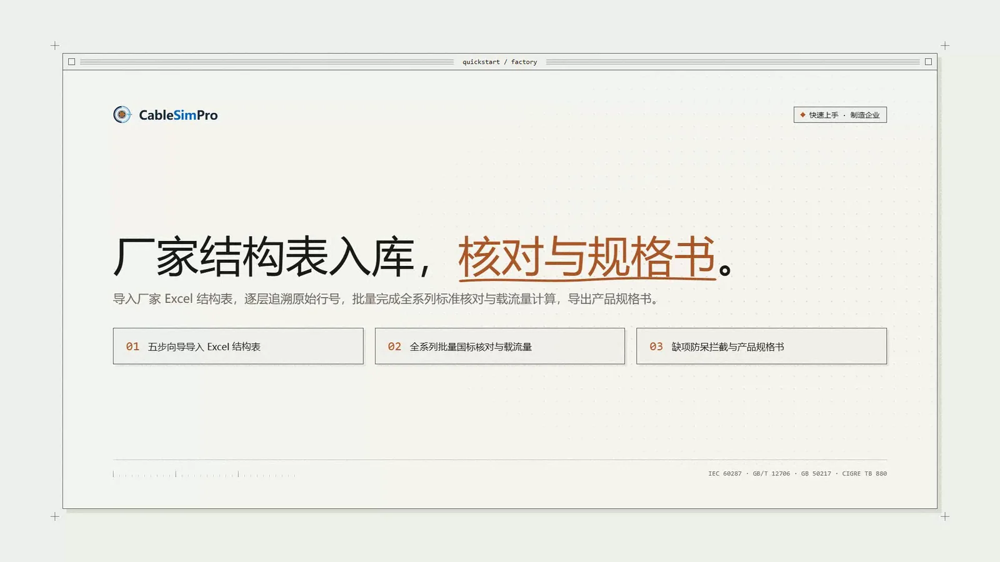
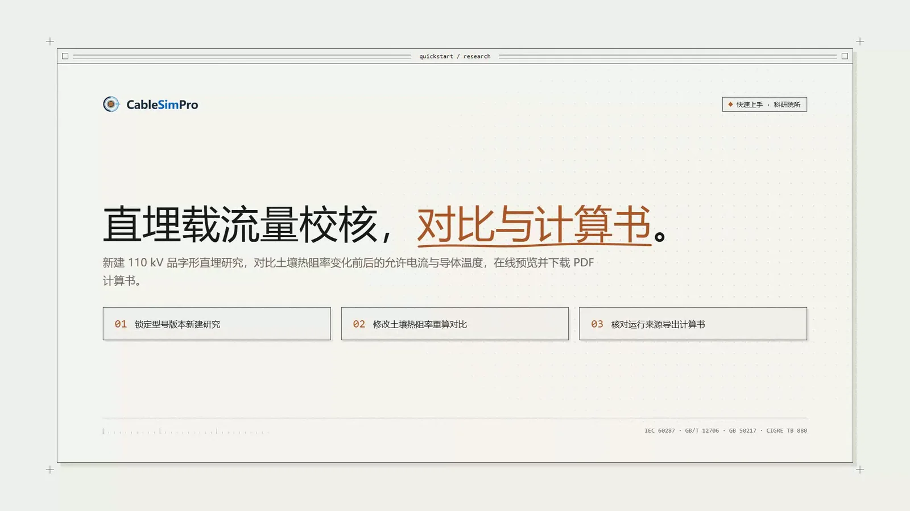

# CableSimPro

面向电缆制造企业与科研院所的垂直设计与载流量计算平台。在同一份可追溯工程数据上闭环完成**电缆型号设计、标准载流量校核、有限元热仿真复核、受控工程智能体（Agent）协同与正式技术文件交付**。

> **在线文档站（树状导航 + 实机视频）**：<https://luohui1.github.io/CableSimPro/>
>
> **章节速达**：[01 体系架构](#01--平台四层架构与数据追溯树) · [02 实机演示视频](#02--四条核心流程实机演示含配音与字幕) · [03 全站文档导航树](#03--全站文档导航树4-层--6-分支--51-页) · [04 安装与启动](#04--快速启动离线发行与备份恢复) · [05 封签插件树](#05--第一方封签插件体系4-类--12-个插件) · [06 源码工程树与门禁](#06--仓库源码树工程边界与测试门禁)


---

## 01 · 平台四层架构与数据追溯树

宿主内核**不内置任何计算公式**；所有电热算法与产品标准核对均以 `cablesim.plugin/2` 独立子进程插件运行，遵循三大工程底线：**缺数据明确终止（绝不经验公式兜底）**、**全链路 SHA-256 快照可追溯**、**AI 提案与人工签审严格分离**。

```text
CableSimPro 系统体系树
├── [L1 正式交付与签审层] ── 仅复述已校验的保存运行快照，签审由人另行确认（GB/T 8170 修约）
│   ├── 研究计算书（PDF / HTML，含四级签栏与独立逐值追溯页）
│   ├── 产品规格书（客户版 / 内部审核版 PDF，绑定五项计算通道摘要）
│   └── 多工况载流量表与参数扫描（PDF / Excel / 带来源摘要 CSV）
│
├── [L2 四大业务工作流] ── React 工作台 + 受控 Agent 对话边车（同一套后端预检与锁校验）
│   ├── 电缆型号库 ── CSV / XLSX 厂家结构表五步导入、逐格原表行号追溯、全系列批量核对与计算
│   ├── 电缆型号设计 ── 分层截面编辑、OCCT 实体推导、电气参数、短路容量与版本发布流
│   ├── 载流量与仿真研究 ── 稳态载流量、参数扫描、问询选型、交叉热源降额、超算有限元对照
│   └── Agent 工程智能体 ── 只读快照查询、“待你审阅”字段级修改提案卡、人工单步点击接受
│
├── [L3 封签计算插件层] ── 12 个第一方插件（逐文件 SHA-256 封签校验，不一致即拒算）
│   ├── 本机标准解析 ── IEC 60287-1-1/2-1、GB 50217 附录 D、IEC 60949 短路、简化热网络
│   ├── 标准尺寸核对 ── GB/T 12706、GB/T 11017、GB/T 3956 逐条核对 + 离线只读标准依据库
│   └── 超算原生求解 ── Slurm 集群稳态/暂态导热、时谐涡流损耗、电热耦合与网格收敛证据
│
└── [L4 宿主工程底座] ── FastAPI Kernel + 本机 SQLite 工作区
    └── SI 国际单位制领域事实 · 参数锁与冲突检测 · 撤销/重做 · 不可变运行快照 · 在线备份恢复
```

| | |
| --- | --- |
|  |  |
| **型号设计**：分层截面、分层尺寸表与型号名片 | **载流量研究**：品字形直埋截面、工况与允许电流 |
|  |  |
| **Agent 协同**：只读调取保存结论并生成待审提案卡 | **型号库**：厂家结构表入库后的系列与批量操作 |

---

## 02 · 四条核心流程实机演示（含配音与字幕）

全部视频录制自随安装包发布的示例工程库，点击封面即可跳转文档站按需播放（1080p，含中文配音与字幕）：

| `01` 平台全链路总览（`01:42`） | `02` 制造企业：结构表至产品规格书（`01:39`） |
| --- | --- |
| [](https://luohui1.github.io/CableSimPro/#walkthroughs) | [](https://luohui1.github.io/CableSimPro/docs/quickstart/factory/) |
| 串联 Excel 结构表入库、全系列核对、110 kV 直埋敏感性对比、Agent 提案审阅与 `5×5` 电缆热模型验证矩阵 | 五步向导导入厂家结构表 → 抽检原始行号 → 11 个规格批量核对与载流量计算 → `3×240` 缺项拒算与 `3×300` 规格书导出 |
| **`03` 科研院所：直埋校核至计算书（`01:43`）** | **`04` 工程智能体（Agent）实操与签发（`01:14`）** |
| [](https://luohui1.github.io/CableSimPro/docs/quickstart/research/) | [](https://luohui1.github.io/CableSimPro/docs/guide/agent/) |
| 新建 110 kV 品字形直埋研究 → 预检求解 `944.8 A` → 热阻率改 `1.5 K·m/W` 重算 `801.1 A` → SI 差异对比与 PDF 计算书 | 只读工具调取保存快照 `748.3 A` → “待你审阅”修改提案卡与拒绝抽屉 → 单步接受重算 → 导出四级签栏正式计算书 |

---

## 03 · 全站文档导航树（4 层 · 6 分支 · 51 页）

在线文档站（[luohui1.github.io/CableSimPro/docs/](https://luohui1.github.io/CableSimPro/docs/)）按以下**四层 × 六分支 × 三级树**组织，点击任一节点直达对应章节：

- **第一层 · 入门与部署运维**
  - **`01` 快速上手（双主线实操）**
    - ├─ [制造企业：从结构表到正式规格书（含视频）](https://luohui1.github.io/CableSimPro/docs/quickstart/factory/)
    - └─ [科研院所：从新建工程到计算书（含视频）](https://luohui1.github.io/CableSimPro/docs/quickstart/research/)
  - **`02` 安装、配置与运维**
    - ├─ [下载与离线安装](https://luohui1.github.io/CableSimPro/docs/install/) · [release.toml 参数配置](https://luohui1.github.io/CableSimPro/docs/install/configuration/) · [升级、备份与恢复](https://luohui1.github.io/CableSimPro/docs/install/upgrade-restore/)
    - ├─ 外部服务接入：[接入 AI 模型](https://luohui1.github.io/CableSimPro/docs/install/model/) · [Agent 对话服务排错](https://luohui1.github.io/CableSimPro/docs/install/agent/) · [Slurm 超算集群接入](https://luohui1.github.io/CableSimPro/docs/install/hpc/)
    - └─ 内网与底层说明：[内网多人部署](https://luohui1.github.io/CableSimPro/docs/install/intranet/) · [部署文档站](https://luohui1.github.io/CableSimPro/docs/install/docs-site/) · [离线发行技术说明](https://luohui1.github.io/CableSimPro/docs/install/reference/release-installation/) · [工程库维护说明](https://luohui1.github.io/CableSimPro/docs/install/reference/database-operations/)
- **第二层 · 工作台与智能体手册**
  - **`03` 用户指南（按业务模块）** → [总览](https://luohui1.github.io/CableSimPro/docs/guide/)
    - ├─ 电缆型号与设计：[型号库与结构表导入](https://luohui1.github.io/CableSimPro/docs/guide/type-library/) · [型号设计与规格书审核](https://luohui1.github.io/CableSimPro/docs/guide/type-design/) · [材料、部件与标准规则库](https://luohui1.github.io/CableSimPro/docs/guide/resources/)
    - ├─ 载流量与热仿真：[载流量研究、扫描与选型](https://luohui1.github.io/CableSimPro/docs/guide/ampacity-study/) · [有限元热场与电热仿真](https://luohui1.github.io/CableSimPro/docs/guide/simulation/)
    - └─ 正式交付与智能体：[正式交付文件与四级签栏](https://luohui1.github.io/CableSimPro/docs/guide/deliverables/) · [Agent 的用法与权限边界（含视频）](https://luohui1.github.io/CableSimPro/docs/guide/agent/)
- **第三层 · 算法依据与插件扩展**
  - **`04` 计算方法与标准依据** → [方法体系与验证等级](https://luohui1.github.io/CableSimPro/docs/methods/)
    - ├─ 标准解析与核对：[IEC 60287 稳态载流量](https://luohui1.github.io/CableSimPro/docs/methods/iec-60287/) · [GB 50217 载流量校正](https://luohui1.github.io/CableSimPro/docs/methods/gb-50217/) · [产品标准尺寸与电阻核对](https://luohui1.github.io/CableSimPro/docs/methods/standard-check/)
    - ├─ 交叉校核与有限元：[简化热网络交叉校核](https://luohui1.github.io/CableSimPro/docs/methods/thermal-network/) · [有限元热场与电热对照](https://luohui1.github.io/CableSimPro/docs/methods/fem/) · [12 个插件能力清单](https://luohui1.github.io/CableSimPro/docs/methods/catalog/)
    - └─ 算例推导底稿（8 篇）：[口径与热网络](https://luohui1.github.io/CableSimPro/docs/methods/notes/rating-basis/) · [IEC 60287 逐项依据](https://luohui1.github.io/CableSimPro/docs/methods/notes/iec-60287/) · [电气参数与短路](https://luohui1.github.io/CableSimPro/docs/methods/notes/type-electrical/) · [型号载流量表](https://luohui1.github.io/CableSimPro/docs/methods/notes/type-rating-table/) 等
  - **`05` 插件规范与二次开发** → [插件开发总览](https://luohui1.github.io/CableSimPro/docs/develop/)
    - ├─ 协议与接口：[插件清单字段（plugin.json）](https://luohui1.github.io/CableSimPro/docs/develop/plugin-manifest/) · [声明式插件示例](https://luohui1.github.io/CableSimPro/docs/develop/examples/) · [宿主 REST 接口参考（252 端点）](https://luohui1.github.io/CableSimPro/docs/develop/api/)
    - └─ 宿主契约（3 篇）：[正式交付文件契约](https://luohui1.github.io/CableSimPro/docs/develop/host/formal-deliveries/) · [资源与工程资产](https://luohui1.github.io/CableSimPro/docs/develop/host/asset-workspace/) · [敷设场景](https://luohui1.github.io/CableSimPro/docs/develop/host/installation-scene/)
- **第四层 · 附录参考与工程边界**
  - **`06` 常见问题、术语与工程边界**
    - └─ [常见问题排查（FAQ）](https://luohui1.github.io/CableSimPro/docs/reference/faq/) · [工程术语与符号对照](https://luohui1.github.io/CableSimPro/docs/reference/glossary/) · [版本更新说明](https://luohui1.github.io/CableSimPro/docs/releases/) · [当前适用边界与已知限制](https://luohui1.github.io/CableSimPro/docs/releases/limitations/)

---

## 04 · 快速启动、离线发行与备份恢复

### 从源码一键启动（开发与评估）

需要 **Python 3.11+、Node.js 22.12+（含 npm）和 Git**，首次启动联网准备依赖与 CAD 资产：

```powershell
python scripts/run_demo.py
```

启动器在 `.data/release/` 下准备独立环境并生成教学示例库，自动打开 <http://127.0.0.1:8100/>（前端、`/api` 与 Agent 边车一体联动；后续启动保留已有数据，按 `Ctrl+C` 退出）。

- **离线安装包**：`scripts/build_release.py` 打包 Windows x64 / Linux x86_64 离线 ZIP（内置 Python、固定版本 Node.js 与 Agent 边车），安装端无需联网或管理员权限，详见 [下载与安装](https://luohui1.github.io/CableSimPro/docs/install/)。
- **接入 AI 模型**：在“设置 · AI 模型”配置兼容端点，密钥仅从系统凭据或环境变量读取，不写入工程库，详见 [接入模型](https://luohui1.github.io/CableSimPro/docs/install/model/)。
- **在线备份与独占恢复**：`scripts/workspace_db.py backup / restore`（附 SHA-256 校验回执与安全副本），详见 [升级与备份恢复](https://luohui1.github.io/CableSimPro/docs/install/upgrade-restore/)。

| 常见情况 | 处理方法 |
| --- | --- |
| `8100` 端口已占用 | 确认是否已有运行实例；或执行 `python scripts/run_demo.py --port 8101` 改用 `8101` 端口 |
| 三维视口或规格书提示缺少 `cadquery` | 在发布环境中安装原生依赖后重启：`.\.data\release\venv\Scripts\python.exe -m pip install -r plugins/requirements-native.txt` |
| 接口返回 `409` 插件封签或依赖不一致 | 交由维护人员核对程序与插件版本；修复前严禁通过篡改工程参数绕过校验 |
| 超算未配置或暂不可达 | 有限元与批量仿真无法发起新作业；本机 IEC 计算、参数扫描、编辑、导出与已保存结果查阅均不受影响 |

---

## 05 · 第一方封签插件体系（4 类 · 12 个插件）

所有第一方插件位于 `plugins/<id>/plugin.json`（遵循 [CableSimPro-Plugins/SPEC.md](https://github.com/luohui1/CableSimPro-Plugins/blob/main/SPEC.md)），按工程职责划分为四类：

```text
plugins/（12 个逐文件 SHA-256 封签插件）
├── 1. 电缆实体建模与产品标准核对
│   ├── cablesim.cable-geometry (v1.1.1) ────── 分层截面、理论外径与用料推导、OCCT 实体与 STEP 导出
│   ├── cablesim.standard-check (v1.8.6) ────── 按 GB/T 12706、11017、3956 逐条核对结构尺寸与 R₂₀
│   └── cablesim.standards-basis (v0.9.1) ───── 离线只读标准依据库（尺寸、电阻、试验值及原书页码）
│
├── 2. 解析载流量、电气参数与热网络校核（本机求解）
│   ├── cablesim.iec60287 (v1.2.1) ──────────── IEC 60287 稳态温度与允许电流（直埋/排管/回填/多回互热）
│   ├── cablesim.gb50217-correction (v1.0.7) ── GB 50217 附录 D 载流量校正（系数经依据库逐项核验）
│   ├── cablesim.type-electrical (v1.2.5) ───── 型号电气参数与 IEC 60949 短路热稳定容量计算
│   └── cablesim.thermal-network (v1.0.2) ───── 可审计简化稳态热网络，用于同输入交叉校核
│
├── 3. 有限元热仿真、参考核对与混合代理模型（超算 Slurm / 基准对照）
│   ├── cablesim.simulation (v1.7.2) ────────── 多区域稳态导热、时谐涡流损耗、暂态热与电热耦合
│   ├── cablesim.native-reference (v1.0.9) ──── CAD、网格、有限元、电热与半空间线热源解析参考
│   ├── cablesim.hybrid-rating (v1.1.1) ─────── IEC 基线 + 收敛有限元修正的混合载流量研究（默认仅参考）
│   └── cablesim.comsol-bridge (v1.0.4) ─────── 可选：连接本机已安装 COMSOL 做内部基准对照
│
└── 4. 技术资料识别辅助
    └── cablesim.datasheet-extract (v1.0.2) ─── 厂家资料参数识别，保留页码与位置，仅作人工核对候选
```

> **独立电缆热模型 v2.0.0（验证预览）**：以双级收敛有限元解为基准，覆盖 `5 种单芯结构 × 5 类敷设` 共 25 个组合、150 例独立复核算例，最大载流量相对误差 `0.35%`、最大导体温度偏差 `0.22 °C`（超训练包络自动拒算；现场验证与审批进行中，交互验证矩阵见[文档站首页](https://luohui1.github.io/CableSimPro/)）。

---

## 06 · 仓库源码树、工程边界与测试门禁

```text
CableSimPro/
├── backend/              # FastAPI 宿主：kernel/ 编排与快照交付 · domain/ SI 领域事实 · plugin_host/ v2 执行器 · harness/ Agent 工具层
├── frontend/             # 正式 React 工作台与路由（OCCT 原生源码位于 src/features/cad/native/，E2E 回归位于 scripts/）
├── studio/               # Agent 对话界面与独立 Node 边车服务
├── plugins/              # 12 个第一方插件源码、v2 清单与封签索引 registry.json
├── cablesim_sdk/         # 宿主与插件共用的物理与领域工件契约
├── plugin-spec/          # v2 插件清单与物理工件 JSON Schema
├── site/                 # 中文产品文档站（Fumadocs + Next.js 静态导出，含四层树状导航与 OpenAPI 参考）
├── docs/                 # 产品需求（product/）、系统架构（design/、architecture/）、插件底稿与计算方法（METHOD.md）
├── scripts/              # 启动器 run_demo.py、离线打包 build_release.py、封签 plugin_sdk.py、卫生门禁 check_hygiene.py
└── tests/ & plugin-tests/# 后端单元/集成/卫生测试与原生插件回归套件
```

### 工程边界声明

- 本平台为工程计算与交叉复核工具，并非经认证的自动签审系统；正式签发前须由工程师复核，导出 PDF 不代表完成厂内批准或型号发布。
- 每种方法仅在清单声明的适用范围内求解，超范围或缺失输入一律明确拒算并列明原因，不使用经验默认值替代。
- 有限元、批量仿真与收敛计算仅提交至超算集群执行；本机保留轻量单元测试与标准代数计算。

### 开发与门禁验证

```sh
python -m pip install -r backend/requirements-dev.txt
python -m pytest                    # 后端测试 + 仓库卫生门禁（scripts/check_hygiene.py）
npm --prefix frontend test          # 前端单元测试
npm --prefix site run build         # 构建文档站 + 内部信息扫描（check:links / check:search 校验死链与搜索）
python scripts/plugin_sdk.py verify # 全部第一方插件清单与 SHA-256 封签核验
```

版本号唯一来源为 `backend/__init__.py`；开发与仓库卫生规范见 [AGENTS.md](AGENTS.md)。
