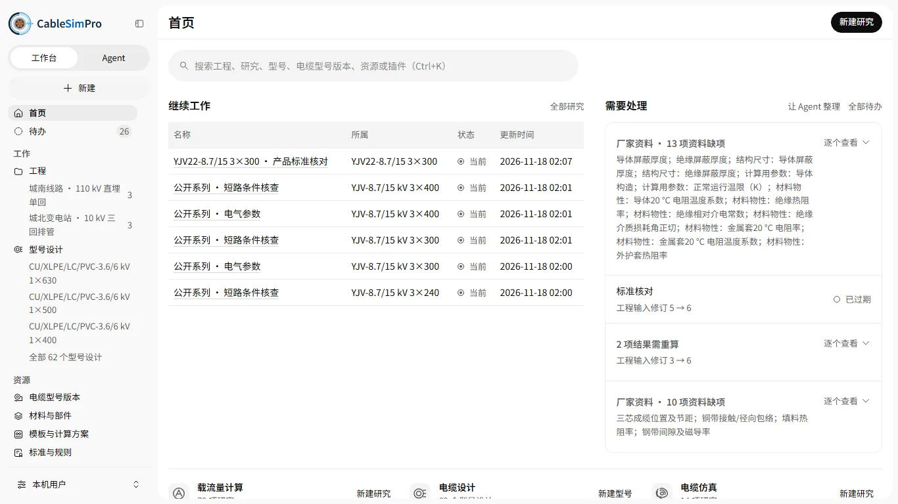
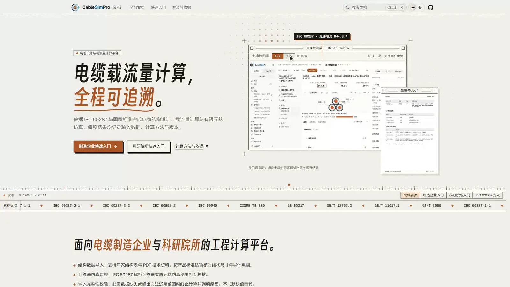
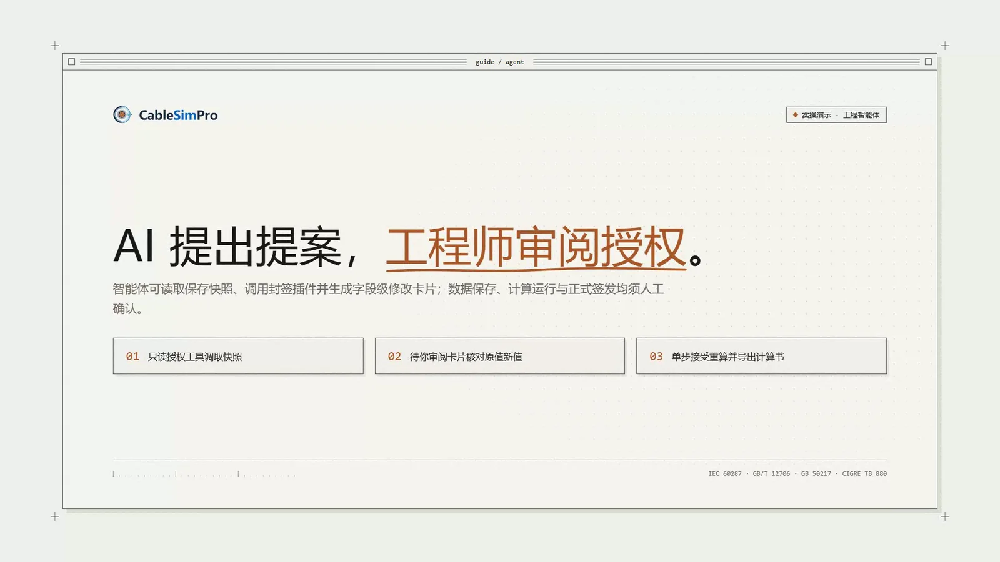
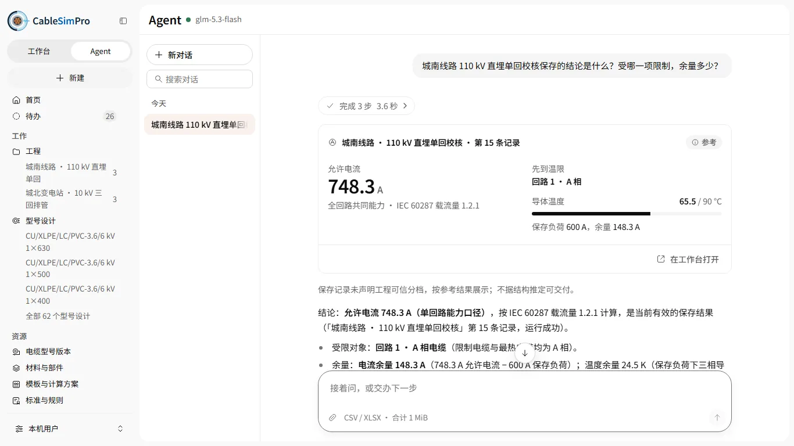
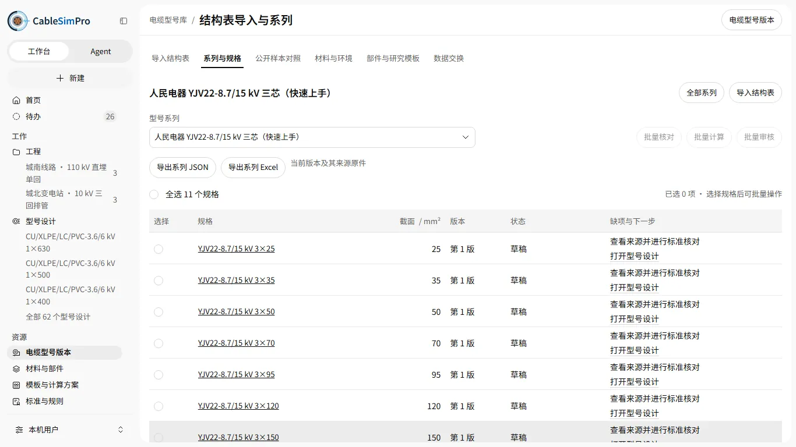

# CableSimPro

电缆行业垂直的设计与载流量计算平台：在同一份可追溯的工程数据上完成**电缆型号设计、标准载流量校核、有限元热仿真复核、受控工程智能体（Agent）协同与正式技术文件交付**。所有计算方法均以封签插件提供，宿主只负责工程版本、不可变运行快照、来源追溯、审批与交付；缺数据明确终止，每项结果均可追溯到输入、方法与版本。

> **在线文档与实机演示视频**：<https://luohui1.github.io/CableSimPro/>
> - [文档总览](https://luohui1.github.io/CableSimPro/docs/) · [制造企业快速上手（含视频）](https://luohui1.github.io/CableSimPro/docs/quickstart/factory/) · [科研院所快速上手（含视频）](https://luohui1.github.io/CableSimPro/docs/quickstart/research/) · [Agent 实操与边界（含视频）](https://luohui1.github.io/CableSimPro/docs/guide/agent/) · [下载与安装](https://luohui1.github.io/CableSimPro/docs/install/) · [计算方法与依据](https://luohui1.github.io/CableSimPro/docs/methods/)



- **文档源码**：`site/` 为中文文档站点（Fumadocs + Next.js 静态导出，离线可用）；执行 `npm --prefix site ci && npm --prefix site run dev` 可在本机预览
- **工程与架构文档**：产品需求 [docs/product/PRD.md](docs/product/PRD.md) · 系统架构 [docs/design/SYSTEM_ARCHITECTURE.md](docs/design/SYSTEM_ARCHITECTURE.md) · 计算方法 [docs/METHOD.md](docs/METHOD.md) · 开发与卫生规则 [AGENTS.md](AGENTS.md)

## 实机操作演示（点击封面在线播放，含中文配音与字幕）

| 平台全链路总览（`01:42`） | 制造企业：结构表至产品规格书（`01:39`） |
| --- | --- |
| [](https://luohui1.github.io/CableSimPro/#walkthroughs) | [](https://luohui1.github.io/CableSimPro/docs/quickstart/factory/) |
| 串联 Excel 结构表入库、全系列核对、110 kV 直埋敏感性对比、Agent 提案审阅与 `5×5` 电缆热模型验证矩阵 | 五步向导导入厂家结构表 → 逐项追溯原始行号 → 11 个规格批量核对与载流量计算 → 缺项拦截与多章节规格书 |
| **科研院所：直埋校核至计算书（`01:43`）** | **工程智能体（Agent）实操与签发（`01:14`）** |
| [](https://luohui1.github.io/CableSimPro/docs/quickstart/research/) | [](https://luohui1.github.io/CableSimPro/docs/guide/agent/) |
| 新建 110 kV 品字形直埋研究 → 预检求解 `944.8 A` → 土壤热阻率改 `1.5 K·m/W` 重算 `801.1 A` → SI 差异对比与 PDF 计算书 | 只读工具调取保存快照 `748.3 A` → “待你审阅”字段级修改卡片 → 人工单步接受重算 → 导出带四级签栏正式计算书 |

## 能做什么

| 模块 | 内容 |
| --- | --- |
| 型号库与型号设计 | 导入厂家结构表（CSV/XLSX）与技术资料候选；按分层截面编辑结构、尺寸与用料；按 GB/T 12706、GB/T 3956 核对结构尺寸和导体电阻；计算电气参数与短路容量；审核、发布型号版本并生成规格书 |
| 载流量计算 | IEC 60287 稳态载流量与运行温度研究，参数扫描，客户问询候选选型，交叉热源降额，GB 50217 附录 D 校正，型号多工况载流量表 |
| 仿真复核 | 有限元稳态导热、时谐涡流损耗、暂态温升与电热耦合，提交到 Slurm 超算集群执行（本机不运行原生求解器），连同网格收敛证据归档并与 IEC 结果对照 |
| Agent 工程智能体 | 在对话中查询快照、发起试算、四步导入厂家结构表、生成计算书与规格书；每一次写入、运行与导出均为“待你审阅”提案卡片，须由工程师单步点击接受 |
| 正式交付 | 计算书、产品规格书、载流量表（PDF 与 Excel），内嵌四级签栏与独立逐值追溯页，显示修约遵循 GB/T 8170 |
| 工程底座 | 本机 SQLite 工作区、参数锁与版本冲突检测、撤销/重做、不可变运行快照、来源追溯、数据库在线备份与独占恢复；12 个第一方插件逐文件 SHA-256 封签校验 |
| 独立电缆热模型（验证预览） | 基于收敛有限元场解训练的代理热模型（`v2.0.0`），覆盖 `5 × 5` 单芯结构与敷设组合、150 例独立复核算例，最大载流量相对误差 `0.35%`、最大导体温度偏差 `0.22 °C`（超范围自动拒算；现场验证与审批进行中，详见[文档站首页矩阵](https://luohui1.github.io/CableSimPro/)） |

| | |
| --- | --- |
|  |  |
| 型号设计：分层截面、分层表与型号名片 | 载流量研究：敷设截面、工况与允许电流 |
|  |  |
| Agent：读取保存的研究结论并给出结果卡片 | 型号库：厂家结构表导入后的系列与规格 |

## 快速开始

需要 **Python 3.11+、Node.js 22.12+（含 npm）和 Git**，首次启动需要联网安装依赖。在仓库根目录执行：

```powershell
python scripts/run_demo.py
```

启动器会准备 CAD 资产、独立 Python 环境和正式前端，首次启动时用公开教学输入生成演示工程库，随后自动打开 <http://127.0.0.1:8100/>。工程数据保存在 `.data/release/engineering.sqlite`，后续启动保留已有数据；按 `Ctrl+C` 退出。

- **Agent 对话**：一键演示会同时启动 Agent 边车（需要 Node.js 22.12+）。模型在“设置 · AI 模型”中配置，密钥只从环境变量或系统凭据读取，不写入配置文件或工程库，见文档 [接入模型](https://luohui1.github.io/CableSimPro/docs/install/model/)。
- **离线安装包**：`scripts/build_release.py` 生成 Windows x64 / Linux x86_64 离线包，自带固定版本 Python、Node.js 与 Agent 边车，安装端无需联网或管理员权限；安装、升级和配置见文档 [下载与安装](https://luohui1.github.io/CableSimPro/docs/install/)。
- **备份与恢复**：`scripts/workspace_db.py backup / restore`，完整步骤见文档 [升级与备份恢复](https://luohui1.github.io/CableSimPro/docs/install/upgrade-restore/)。

### 常见问题

| 遇到的情况 | 怎么处理 |
| --- | --- |
| 8100 端口被占用 | 先确认是否已启动过本程序；否则执行 `python scripts/run_demo.py --port 8101`，改用 <http://127.0.0.1:8101/> |
| 三维视图或规格书提示缺少 `cadquery` | 在启动器创建的环境中安装原生依赖后重启：`.\.data\release\venv\Scripts\python.exe -m pip install -r plugins/requirements-native.txt` |
| 提示插件摘要、封签或依赖不一致（接口返回 409） | 把完整报错交给维护人员核对程序和插件版本；修复前不要改工程参数绕过 |
| 超算未配置或不可用 | 有限元、暂态、电热耦合和批量仿真拿不到新结果；IEC 代数计算、参数扫描、输入编辑、导出和备份照常可用，已保存且校验通过的结果可正常查看导出 |

## 第一方插件清单

| 插件 | 版本 | 作用 |
| --- | --- | --- |
| `cablesim.iec60287` | 1.2.1 | IEC 60287 稳态温度与允许电流：单芯或独立屏蔽三芯，直埋、排管与回填 |
| `cablesim.gb50217-correction` | 1.0.7 | GB 50217 附录 D 载流量校正，系数由标准依据库核验 |
| `cablesim.type-electrical` | 1.2.5 | 型号电气参数与短路容量（IEC 60287、IEC 60949） |
| `cablesim.standard-check` | 1.8.6 | 按 GB 产品标准逐条核对结构尺寸和导体 R₂₀ |
| `cablesim.standards-basis` | 0.9.1 | 离线只读的标准依据库：尺寸、电阻和试验数值及原页出处 |
| `cablesim.cable-geometry` | 1.1.1 | 电缆实体建模：分层截面、外径与理论用料，OCCT 实体与 STEP |
| `cablesim.simulation` | 1.7.2 | 有限元仿真：多区域稳态导热、时谐涡流、稳态/暂态热 |
| `cablesim.native-reference` | 1.0.9 | CAD、网格、有限元、电热与线源参考 |
| `cablesim.hybrid-rating` | 1.1.1 | IEC 基线加有限元热场修正的混合载流量研究（默认仅参考） |
| `cablesim.thermal-network` | 1.0.2 | 简化热网络，用于同输入方法对比 |
| `cablesim.datasheet-extract` | 1.0.2 | 厂家资料参数提取，结果只作为待人工核对的候选 |
| `cablesim.comsol-bridge` | 1.0.4 | 可选：调用用户已安装的 COMSOL 做内部基准比较，平台计算不依赖它 |

插件规范见 [CableSimPro-Plugins/SPEC.md](https://github.com/luohui1/CableSimPro-Plugins/blob/main/SPEC.md) 与在线文档 [插件清单字段](https://luohui1.github.io/CableSimPro/docs/develop/plugin-manifest/)；清单位于 `plugins/<id>/plugin.json`，`plugins/registry.json` 是由清单生成的发布索引。

## 工程边界

- 这是工程计算与复核工具，不是经认证的设计系统；正式签审前必须由工程师复核，下载了 PDF 不代表已完成厂内审核或型号发布。
- 每个方法只在其声明的适用范围内计算，超出范围明确拒绝；缺少数据时列出缺项，不用推测值补齐。
- 标准数据只覆盖已逐格核验的条款；未覆盖的条款在核对结果中标为“未覆盖”。
- 有限元、批量仿真等原生计算只提交到超算执行；超算不可用时，这些新结果无法取得，IEC 代数计算、扫描、编辑和导出不受影响。

## 仓库目录

| 目录 | 内容 |
| --- | --- |
| `backend/` | FastAPI 宿主：工程、研究、运行快照、比较与交付（`kernel/`），SI 领域事实（`domain/`），插件执行器（`plugin_host/`），Agent 工具层（`harness/`） |
| `frontend/` | 正式 React 前端与浏览器回归脚本（OCCT 源码位于 `src/features/cad/native/`） |
| `studio/` | Agent 对话界面与 Node 边车（pi 内核） |
| `plugins/` | 12 个第一方插件，各自的 `src/` 与 v2 清单 |
| `cablesim_sdk/`、`plugin-spec/` | 插件与宿主共用的契约和 JSON Schema |
| `site/` | 中文产品文档网站（Fumadocs + Next.js 静态导出） |
| `docs/` | 产品需求、系统架构、插件说明和计算方法 |
| `tests/`、`plugin-tests/` | 后端与仓库卫生测试；原生插件测试需要原生环境 |

## 开发与测试

```sh
python -m pip install -r backend/requirements-dev.txt
python -m pytest                    # 后端与仓库卫生检查
npm --prefix frontend test          # 前端单元测试
npm --prefix site run build         # 构建文档站并执行内部信息检查
python scripts/plugin_sdk.py verify # 插件清单与封签校验
```

CI（`.github/workflows/ci.yml`）在 `main` 和每个 PR 上运行：卫生与插件目录检查、后端 Python 3.11–3.13、Agent 实测与浏览器走查、文档站构建与死链/搜索抽检、Windows/Linux 离线安装验收。原生仿真回归只在超算自托管 runner 上运行。本地中间文件用 `python scripts/clean.py` 清理。

版本号的唯一来源是 `backend/__init__.py`。
