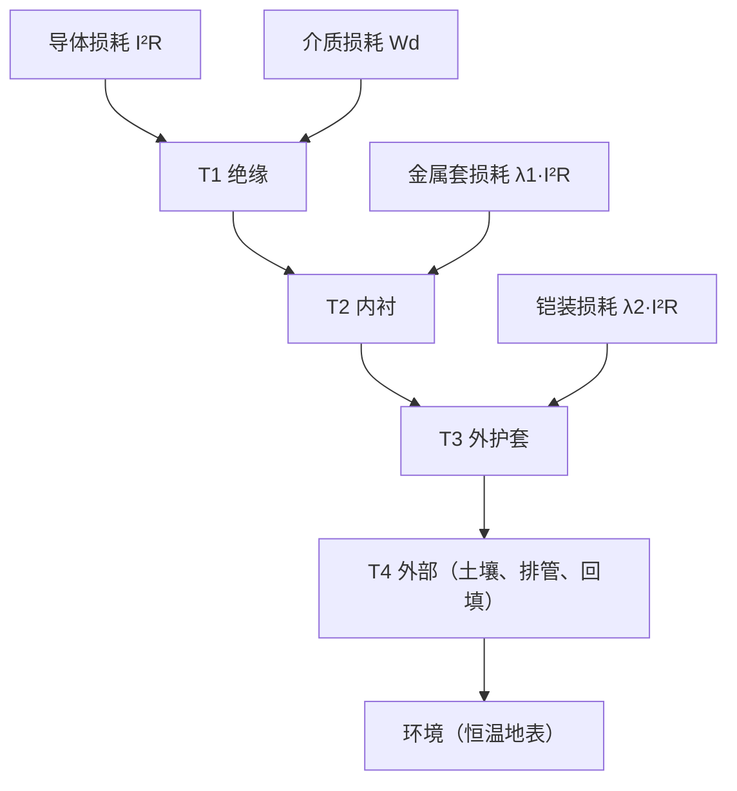

插件 `cablesim.iec60287` 按 IEC 60287-1-1:2023（损耗）和 IEC 60287-2-1:2023（热阻）计算地下电缆在稳态下的导体温度和允许电流，并输出逐项损耗、热阻和互热，便于逐项核对。

## 原理

在给定敷设条件下，导体温度刚好达到允许最高温度时的电流就是载流量。IEC 60287 把电缆和周围介质看成一串热阻，各处损耗沿热路逐段产生温升：

$$
I = \left[\frac{\Delta\theta - W_d\left[0.5\,T_1 + n\,(T_2 + T_3 + T_4)\right]}{R\,T_1 + n\,R\,(1+\lambda_1)\,T_2 + n\,R\,(1+\lambda_1+\lambda_2)\,(T_3 + T_4)}\right]^{0.5}
$$

| 符号 | 含义 | 单位 |
| --- | --- | --- |
| $\Delta\theta$ | 导体允许温度与环境温度之差 | K |
| $R$ | 最高工作温度下的单位长度交流电阻（公式按 SI 取 Ω/m，界面显示为 Ω/km） | Ω/m |
| $W_d$ | 单位长度介质损耗 | W/m |
| $T_1, T_2, T_3$ | 绝缘、内衬、外护套的热阻 | K·m/W |
| $T_4$ | 电缆外部（土壤、排管、回填）的热阻 | K·m/W |
| $n$ | 电缆中承载电流的导体数 | — |
| $\lambda_1, \lambda_2$ | 金属套、铠装损耗与导体损耗之比 | — |

各项损耗从产生的位置开始，依次流过外层热阻散到环境：

直埋单根电缆的外部热阻：

$$
T_4 = \frac{\rho_T}{2\pi}\,\ln\!\left(u + \sqrt{u^2 - 1}\right), \qquad u = \frac{2L}{D_e}
$$

其中 $\rho_T$ 为土壤热阻率（K·m/W），$L$ 为电缆中心埋深，$D_e$ 为电缆外径。多根电缆之间的互热按镜像法叠加：第 $p$ 根电缆因其他电缆 $k$ 产生的温升为

$$
\Delta\theta_p = \frac{\rho_T}{2\pi} \sum_{k \ne p} W_k \,\ln\frac{d'_{pk}}{d_{pk}}
$$

$d_{pk}$ 为两缆中心距离，$d'_{pk}$ 为电缆 $p$ 到电缆 $k$ 关于地表的镜像的距离，$W_k$ 为电缆 $k$ 的总损耗。电阻随温度变化，温度与损耗迭代至收敛。

## 适用范围

- 单芯电缆，以及各芯有独立屏蔽的三芯电缆；直埋、排管和单一矩形回填区；多回路互热。
- 金属套损耗：两端接地的环流、单点接地与交叉互联的涡流；磁性钢带、钢丝铠装损耗；皱纹铝护套（须声明间隙有效热阻率及来源）。
- 交叉热源降额、IEC 60853 应急额定（给定有来源的阶跃响应）、CIGRE TB 880 参考链。

不支持：分层土壤、多种介质分区、土壤干燥区、架空与空气中敷设。单芯多回路的电损耗只在完整平衡三相单回路或已验证的双回平排分支中自动计算，其他排列须给出外部损耗系数及其来源。

## 输入要求

- 型号：各层尺寸与材料、导体 R₂₀、温度系数、绝缘介电常数与介质损耗因数等，全部带来源。
- 敷设：埋深、排列与间距、排管或回填几何、金属套接地方式。
- 环境：地表温度、土壤（回填）热阻率。
- 设计准则：导体允许温度。

缺少任何必需输入时，运行前预检会指出缺哪一项，不会用默认值代替。

## 验证依据与限制

以下为 `steady-rating` 能力的清单内容；其他能力（应急额定、TB 880 参考链、三芯工程参数推导等）见方法清单。逐项依据、工程算例和核对表见IEC 60287 逐项依据与算例。

<PluginMethods id="cablesim.iec60287" only={['steady-rating']} />
