本篇用随软件提供的人民电缆公开结构表（YJV22-8.7/15 kV 三芯钢带铠装），按真实操作走完电缆厂技术部最常用的一条线：**导入厂家结构表 → 核对 → 载流量表 → 正式规格书**，约 15 分钟。截图来自随安装包提供的示例库，数值都是软件实际算出来的。

开始前，按下载与安装启动 CableSimPro。

## 1. 打开结构表导入页

在浏览器地址栏打开 `http://127.0.0.1:8100/resources/cables/structure-import`（地址和端口换成你的服务地址）。这一页是“电缆型号库 · 结构表导入与系列”，上方有“导入结构表、系列与规格、公开样本对照、材料与环境、数据交换”几个标签，导入分五步：选择文件、选择工作表、列映射、系列声明、预览入库。

<Callout>当前版本侧栏还没有这一页的入口，需要直接输入地址。</Callout>

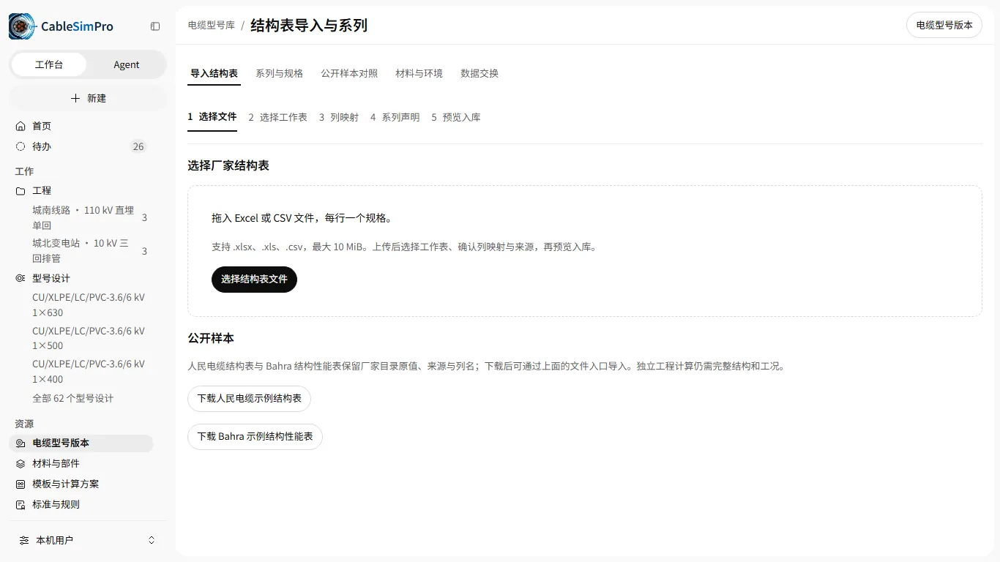

## 2. 上传结构表并选择工作表

<Steps>
<Step>

在“公开样本”里点 **下载人民电缆示例结构表**。导入自己的表时跳过这一步。

</Step>
<Step>

点 **选择结构表文件**，选中要导入的文件。支持 `.xlsx`、`.xls`、`.csv`，单个文件不超过 10 MiB，每行一个规格。

</Step>
<Step>

文件里有多张表时，在 **工作表** 下拉框里选要导入的那张，本例选“表3 YJV22”。下方列出每一列的列名和示例值，用来确认选对了表。

</Step>
<Step>

点 **确认工作表，设置列映射**。

</Step>
</Steps>

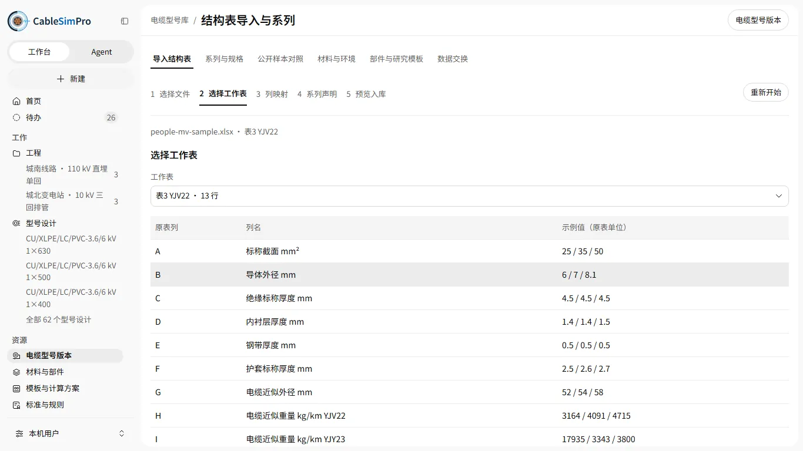

## 3. 确认列映射

软件按列名自动对应目标字段和单位，本例 8 列已经对应。逐列检查右侧的“目标字段与单位”，原表单位不同就在下拉框里改选；“数据起始行”是数据开始的行号。常用的映射可以起名保存，下次在“复用已保存映射”里直接选用。

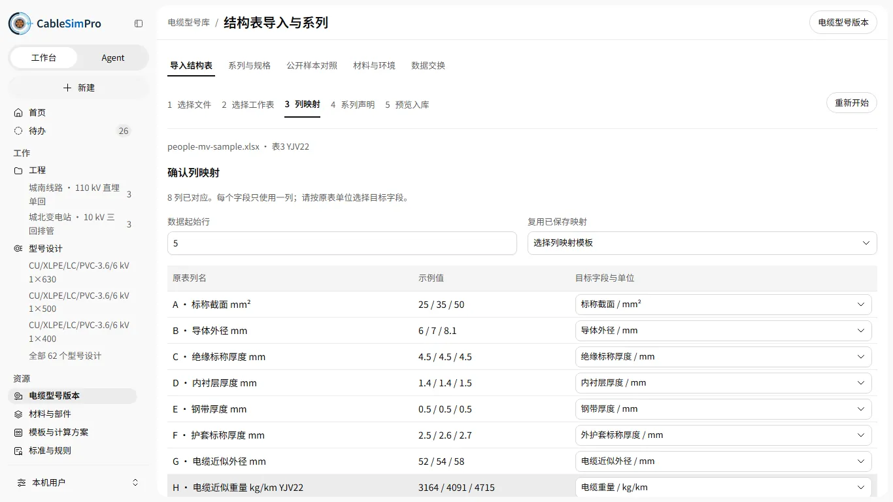

确认后点 **填写系列声明**。

## 4. 填写系列声明

系列声明记录这批数据的身份：系列名称、制造商、型号、额定电压、芯数、数据身份和各层材料。页面顶部自动带出原表出处（手册名称、表号和页码）。本例把系列名称改为“人民电器 YJV22-8.7/15 kV 三芯（快速上手）”，其余保持默认。

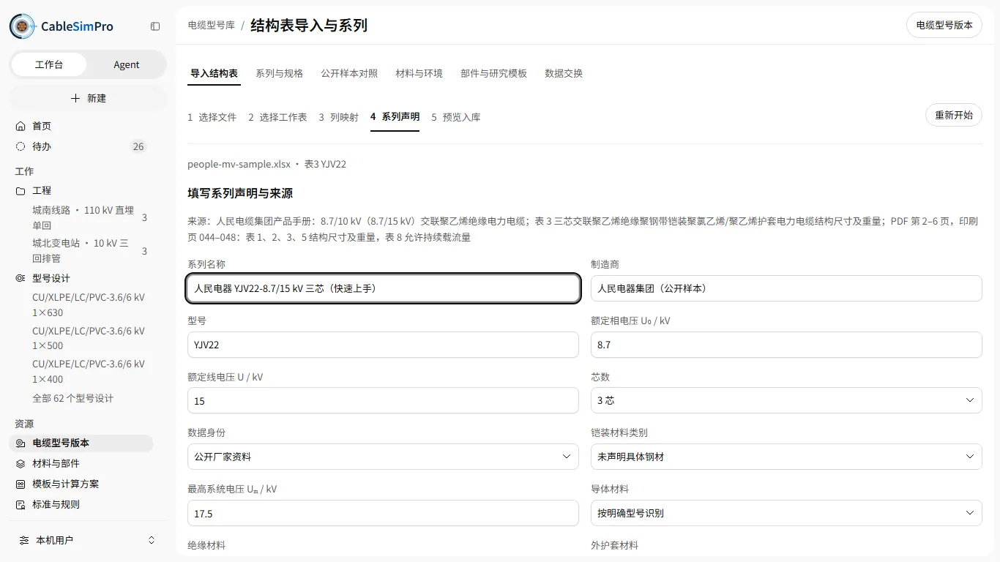

点 **逐行校验并预览**。

## 5. 核对入库预览

预览逐行标出每个规格是“可入库”“缺项”还是“错误”：缺项的规格可以先保存为草稿，但缺少必需数据就不能计算；有错误的行必须更正或明确排除，否则不能入库。本例 11 行全部可入库。原表没有电阻列的规格，导体电阻取 GB/T 3956—2008 表 2 的标准上限，并注明这不是厂家实测值。

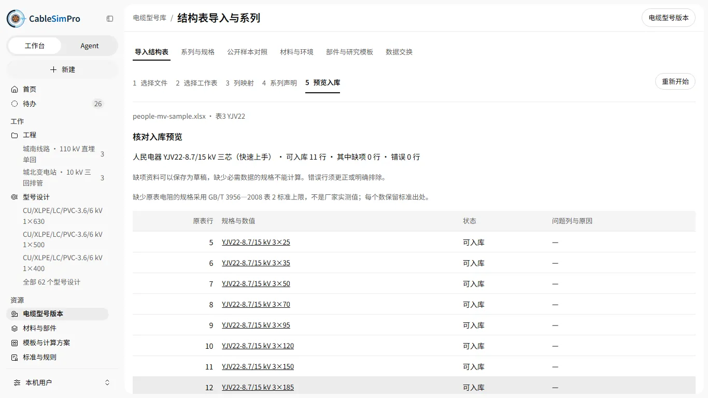

点规格名，可以逐项查看这一行每个数值的来源：原表位置、换算方法版本和可信分档。原表没有列出、按同电压等级公开资料补充的数值（如导体屏蔽厚度）会写明出处，不会冒充厂家数据。

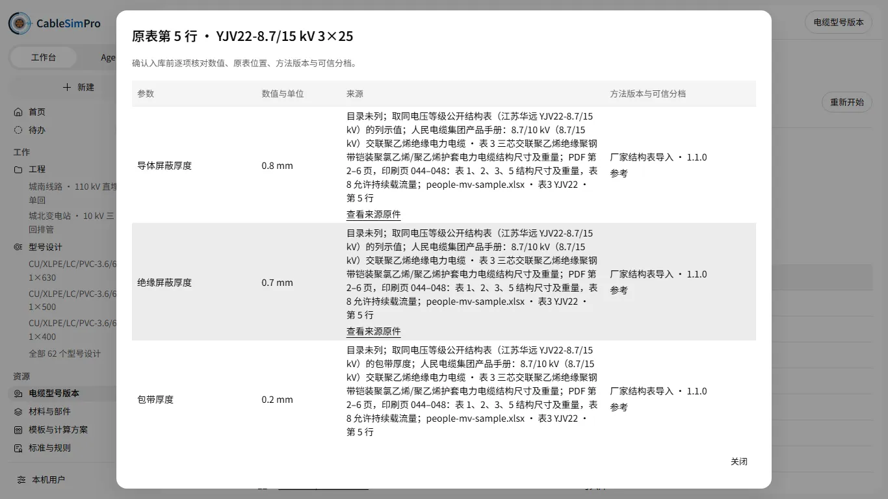

## 6. 确认入库

在预览页底部核对“执行标准版本与来源”，勾选 **确认来源与系列声明**，点 **确认入库 11 个规格**。规格以“草稿 · 待人工核对”的状态进入电缆型号库，都是第 1 版；计算和人工审核在后面分别进行。

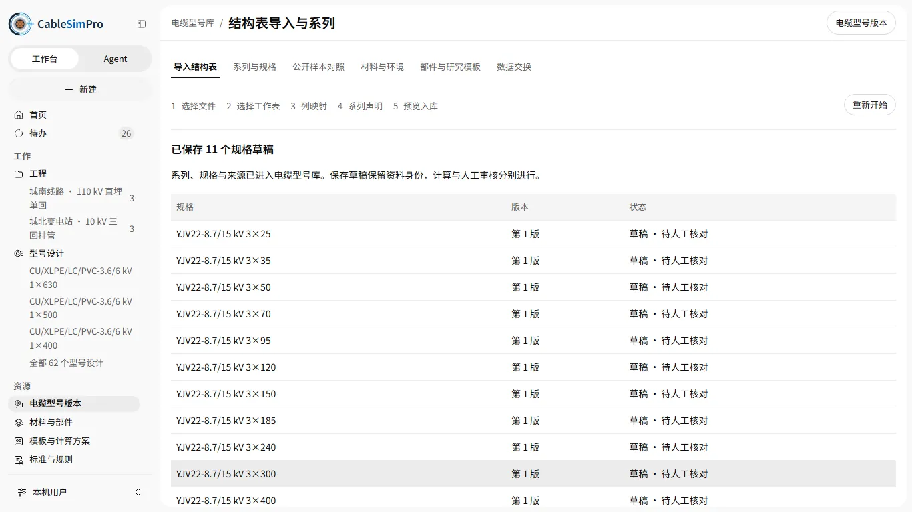

## 7. 批量标准核对

点 **打开系列，核对与计算** 进入系列页，勾选“选择全部规格”，点 **批量核对**，在对话框里勾选“确认所选规格与版本”后执行。每个规格都保存一次真实的产品标准尺寸核对运行，结果列出符合项、缺项和依据库尚未收录的项；标准是否符合与人工是否批准分开判断。

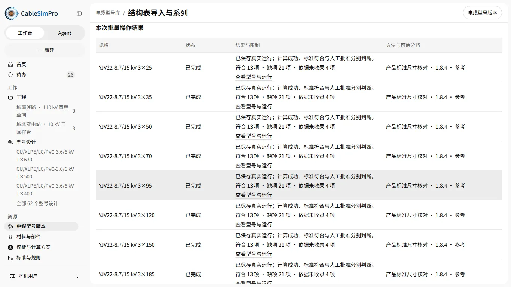

## 8. 批量计算载流量

仍在系列页，点 **批量计算**，填写统一的计算工况，并在“工况来源”“方法参数来源”里写明每个取值的出处。本例取值如下：

| 项目 | 本例取值 |
| --- | --- |
| 工况名称 | 公开样本直埋条件 |
| 中心埋深 | 0.7 m（原表未列，明确声明） |
| 土壤热阻率 | 1.0 K·m/W |
| 环境温度 | 25 °C |
| 交流频率 | 50 Hz |
| 金属套接地 | 两端接地 |
| 护套涡流损耗 | 明确忽略 |
| 土壤热阻公式 | 精确式 |
| 集肤 / 邻近效应系数 kₛ / kₚ | 1 / 1 |
| 求解控制 | 护套初始温度 70 °C，电流收敛容差 1×10⁻⁸ A，最多 300 次迭代 |

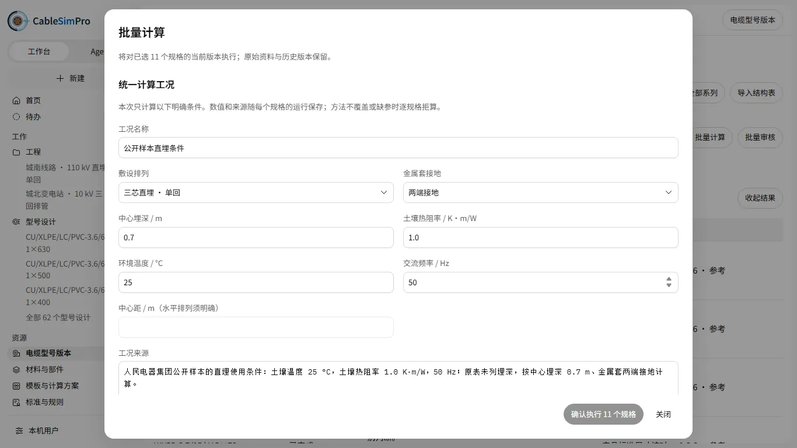

勾选确认后执行。本例 10 个规格算出了直埋载流量；**3×50 被拒算**：它的填充与内衬厚度和芯外径之比超出 IEC 60287 图 6 的适用范围，软件写明原因，不硬算。

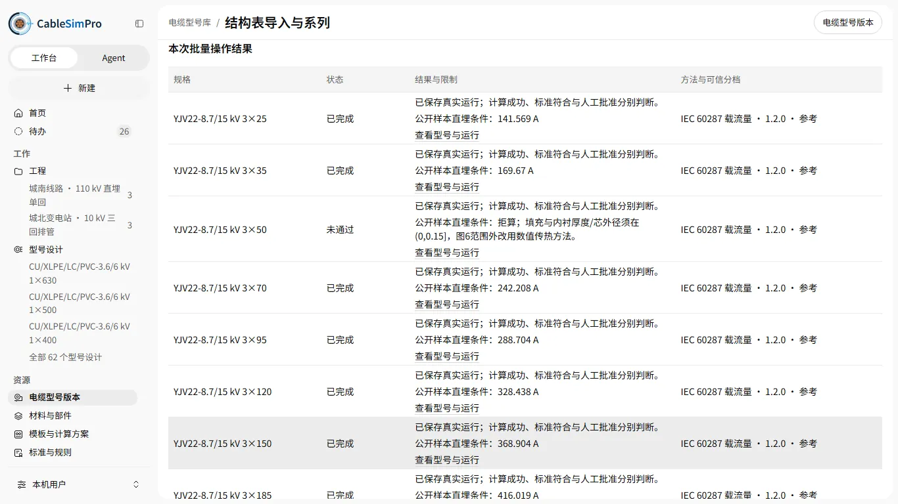

## 9. 查看单个规格的载流量表

在系列页 3×240 这一行点 **打开型号设计**，左侧选 **载流量表**。刚才的工况已作为一条“已计算”的工况保存；点 **添加工况** 可以加入不同的埋深、热阻率或敷设方式，再点 **计算所选工况**，形成完整的型号载流量表。

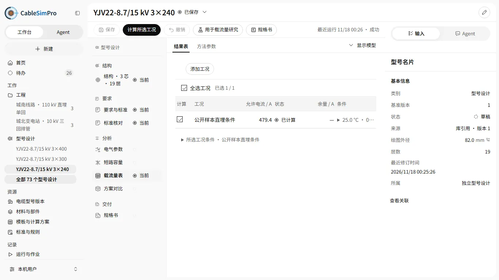

## 10. 生成规格书

工具栏点 **规格书**，再点 **生成规格书**。生成时按需补算结构、电气参数、载流量、短路容量和标准核对五部分结果，已完成的计算会保留。

公开样本只有结构尺寸，没有材料密度、出厂实测值等资料，所以本例提示“结构推导：结构外径或用料缺少完整输入”，并给出阻止发布的项数：

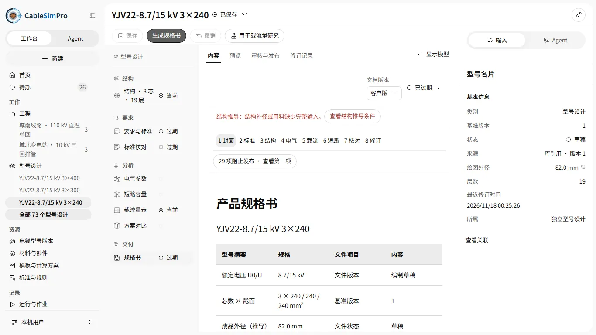

“审核与发布”页把阻止发布的项分成四类：需要工程师补输入、需要出厂实测值、标准依据未覆盖、人工确认关口。逐项补齐后重新生成，再依次 **采纳为版本草稿 → 提交评审 → 批准**；发布后，“生成规格书”按钮变为 **导出 PDF**。

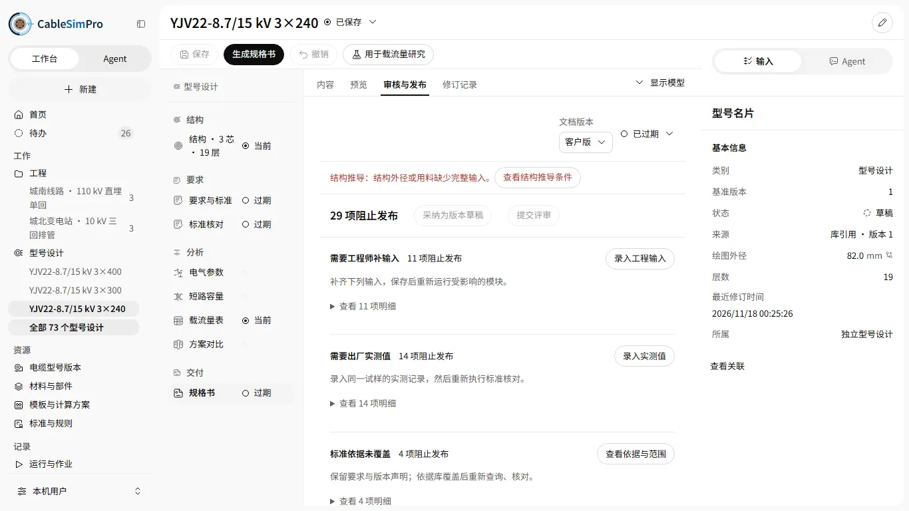

资料完整的型号可以直接生成。示例库里的“YJV22-8.7/15 3×300”（规格书演示）已补齐结构和材料，点 **生成规格书** 后浏览器直接下载 PDF。下图是该文件中载流量章节的一页；未批准发布前，页眉标明编制草稿。

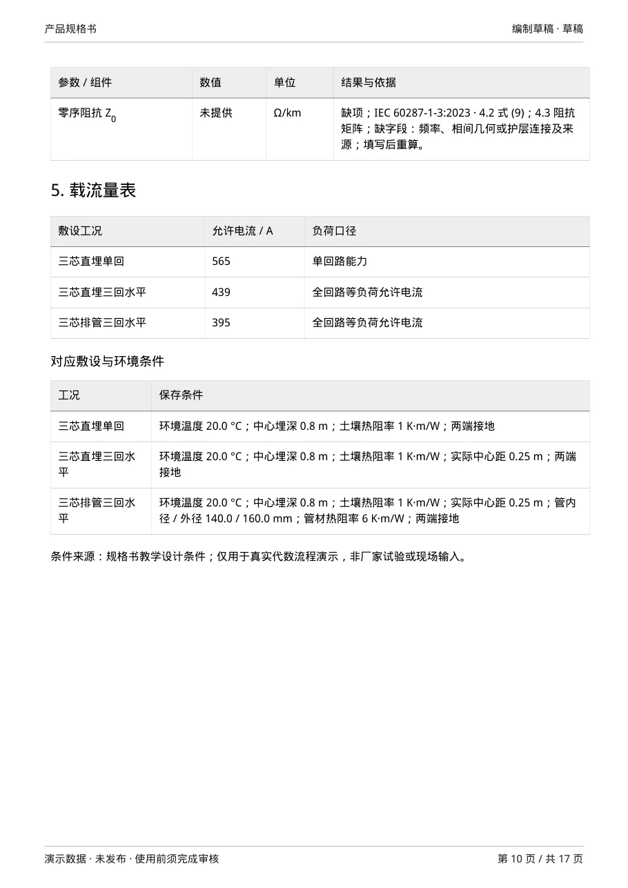

<Callout type="warn">不要为了让规格书生成而填入估计值。缺项应来自厂家实测、图纸或有出处的标准，并在来源里写清楚。</Callout>

## 接下来

- 结构表导入、系列批量操作与改版：型号库与结构表导入
- 型号设计各部分与规格书审核发布：型号设计
- 规格书、载流量表、计算书和研究报告：正式交付文件
