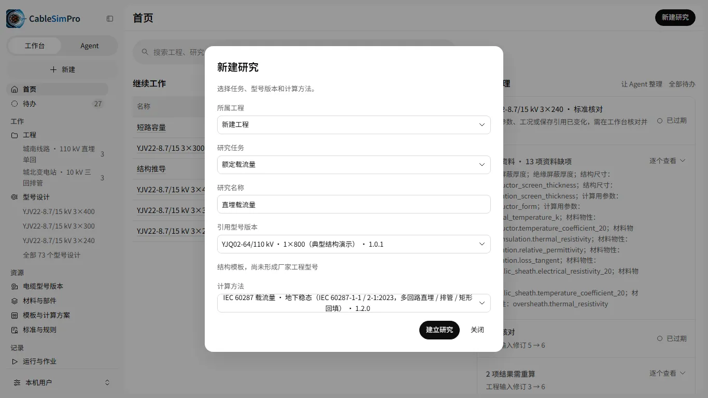
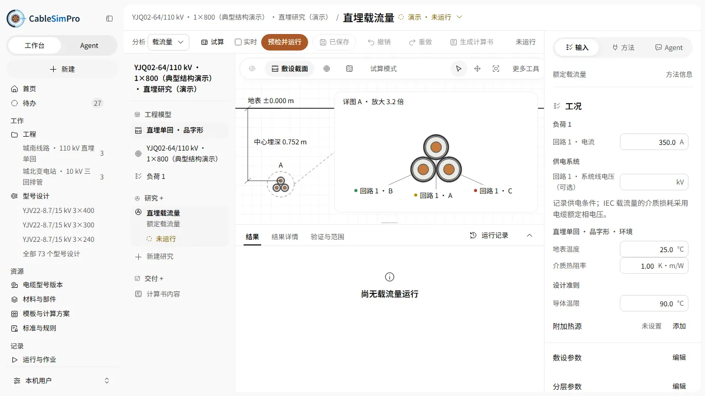
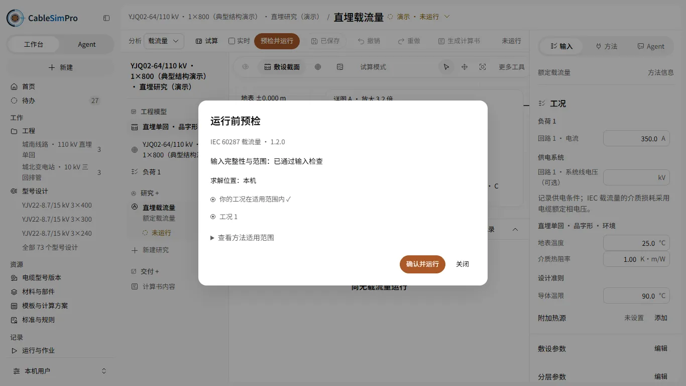
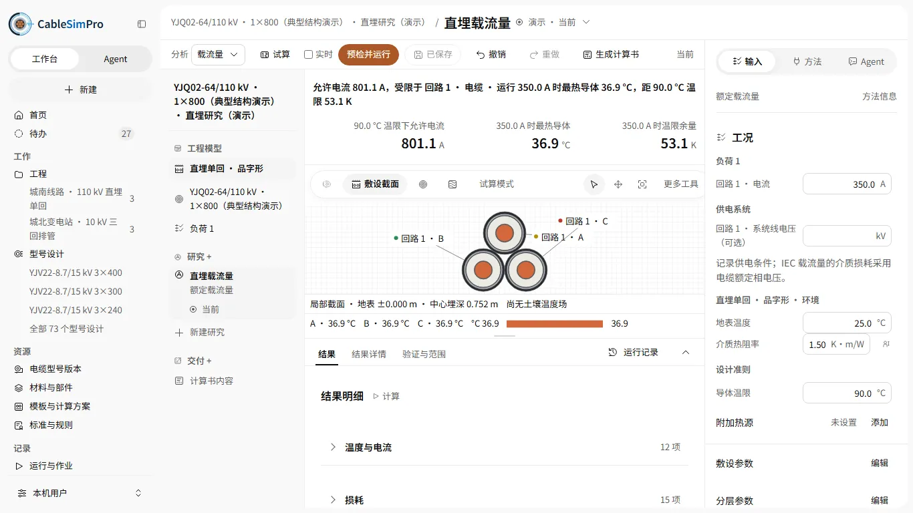
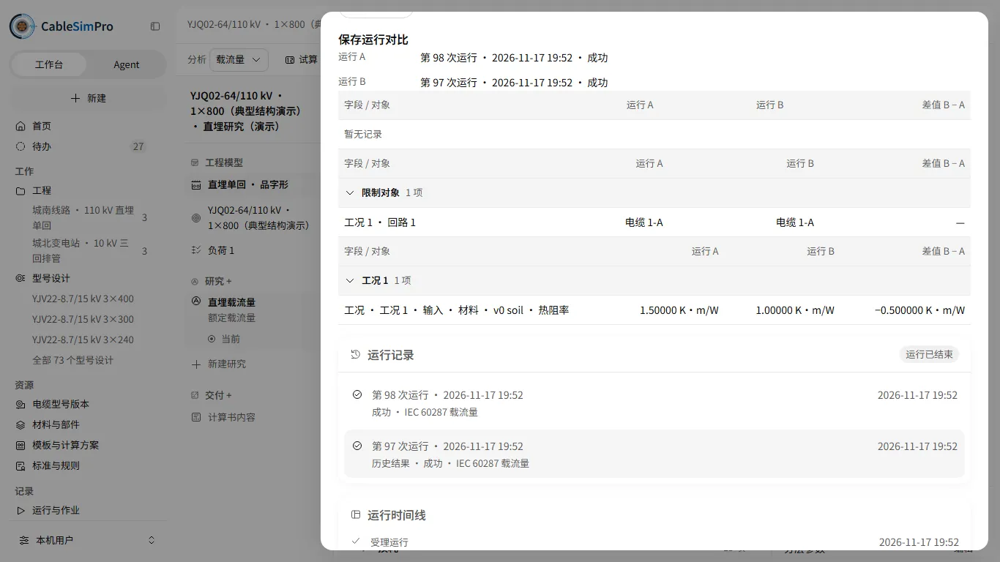
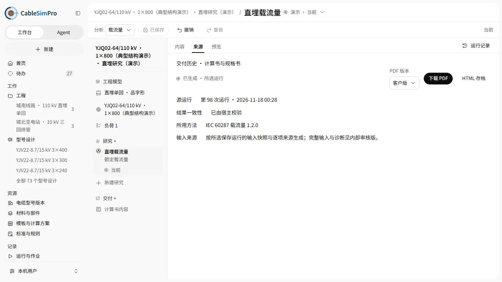
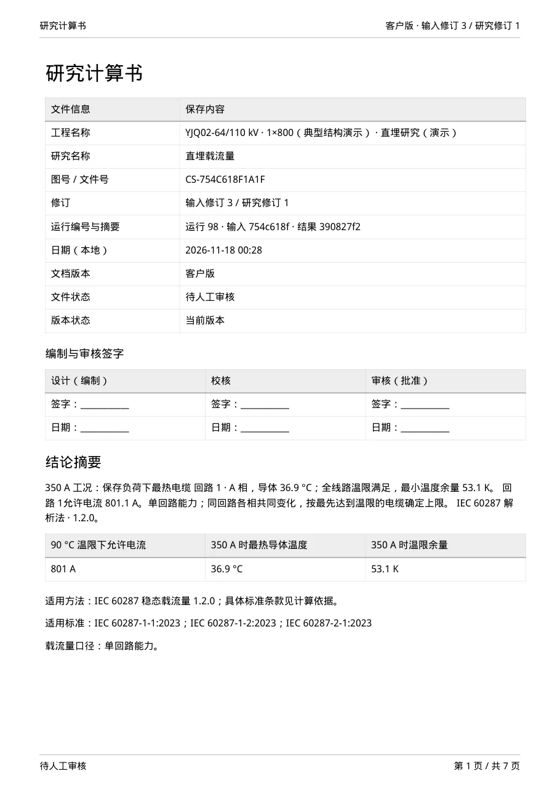

<VideoPlayer kind="research" />

本篇按真实操作走完研究院最常用的一条线：**新建工程 → 直埋载流量研究 → 改条件对比 → 计算书**，约 10 分钟。截图来自随安装包提供的示例库，数值都是软件实际算出来的。

开始前，按[下载与安装](../../install/)启动 CableSimPro，用浏览器打开首页。示例使用“YJQ02-64/110 kV · 1×800（典型结构演示）”电缆，这是一根结构完整、用于演示的 110 kV 铅护套电缆。

## 1. 新建研究，同时新建工程

<Steps>
<Step>

点首页右上角的 **新建研究**。

</Step>
<Step>

在对话框里依次选择：
- **所属工程**：保持“新建工程”，系统会为这次研究新建一个工程；
- **研究任务**：额定载流量；
- **研究名称**：直埋载流量；
- **引用型号版本**：YJQ02-64/110 kV · 1×800（典型结构演示） · 1.0.1；
- **计算方法**：IEC 60287 载流量 · 地下稳态。

</Step>
<Step>

点 **建立研究**。

</Step>
</Steps>

型号版本在研究里是固定引用：之后型号库里出现新版本，这个研究仍按选定的版本计算，除非你主动更换。

## 2. 核对直埋敷设和工况

研究页中间是敷设截面：直埋单回、品字形排列，中心埋深 0.752 m。右侧“输入”页列出工况：回路电流 350 A、地表温度 25.0 °C、介质（土壤）热阻率 1.00 K·m/W、导体温限 90.0 °C。输入旁的来源标记说明数值是工程师填写还是由计算得出；改动后要保存才会参与计算。

## 3. 预检并运行

点工具栏上的 **预检并运行**。运行前预检会检查输入是否完整、工况是否在方法适用范围内，并说明这次在本机还是超算上求解。

<Callout>
如果某一项超出方法范围或缺少必需参数，预检会逐条写明原因，**确认并运行** 按钮不可用。软件不会自己估一个值替你算下去。
</Callout>

确认无误后点 **确认并运行**，几秒后结果出现在研究页顶部。本例在 90.0 °C 温限下的允许电流为 944.8 A；按 350 A 运行时最热导体 33.5 °C，距温限还有 56.5 K。

## 4. 改条件再算一次

<Steps>
<Step>

在右侧“输入”页把 **介质热阻率** 改为 1.5 K·m/W，点工具栏的 **保存修改**。

</Step>
<Step>

再次 **预检并运行**，确认后运行。

</Step>
</Steps>

土壤热阻率变大后散热变差，本例允许电流降到 801.1 A。第一次的结果仍然保存着，研究里标为历史结果，不会被覆盖。

## 5. 对比两次运行

点结果区右上角的 **运行记录**，勾选刚才的两次运行，点 **对比所选运行**。对比表分组列出两次运行的差别，展开“输入差异（SI）”可以看到这次改动的是土壤热阻率；“限制对象”说明两次都是同一根电缆先达到温限。

## 6. 生成计算书

点工具栏的 **生成计算书**。计算书只引用你选定的、已经保存的运行，不会重新计算；“来源”页列出它引用的运行、宿主对结果一致性的校验和所用方法版本，便于审核时逐项追溯。

在“预览”页点 **下载 PDF**，得到客户版计算书。下图是本例下载文件的首页：

## 接下来

- 研究里的工况、敷设模板、参数扫描和结果口径，见[载流量研究](../../guide/ampacity-study/)。
- IEC 60287 的原理、适用范围和验证依据，见[IEC 60287 稳态载流量](../../methods/iec-60287/)。
- 需要有限元温度场或与 IEC 对照时，见[仿真研究](../../guide/simulation/)。
