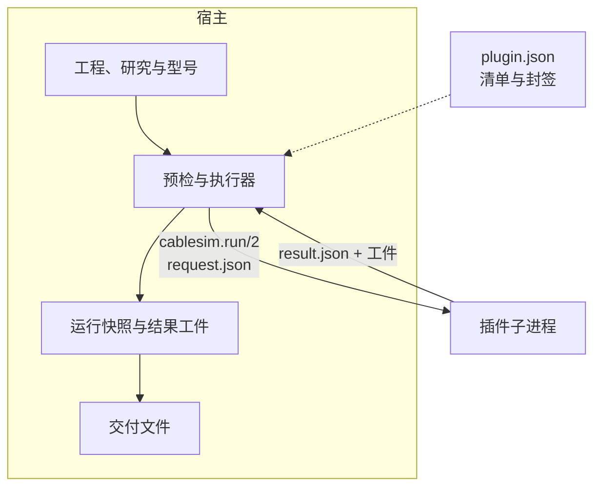

CableSimPro 的宿主只提供工程底座：工程与版本、研究与运行快照、来源追溯、结果工件、交付文件和审批。**所有计算方法都是插件**，宿主不内置算法。这样每个结果都能追溯到具体的插件、方法版本和封签过的源码，新方法可以独立开发、验证和发行。



## 三个协议

| 协议 | 作用 |
| --- | --- |
| `cablesim.plugin/2` | 插件清单：身份、运行方式、权限、资源、计算能力与封签。见[插件清单字段](plugin-manifest/)。 |
| `cablesim.domain/1` | 领域输入：电缆、敷设、负荷、环境和材料，全部为 SI 单位，每个数值可带来源。 |
| `cablesim.run/2` | 子进程运行：宿主写 `input/request.json`，插件写 `output/result.json`，每个工况为 `succeeded`、`not_applicable` 或 `failed`。 |

## SDK

插件与宿主共用的领域模型和仿真工件契约在仓库的 `cablesim_sdk/` 中，例如领域对象（`domain.py`）、载流量结果（`ampacity.py`）、参数单位（`parameter_units.py`）和仿真工件（`simulation_artifacts.py`）。物理工件的 JSON Schema 在 `plugin-spec/` 中。

## 开发环境

在代码仓库根目录：

```sh
python scripts/run_demo.py           # 构建界面并在 127.0.0.1:8100 启动，用发布种子生成示例
python -m pytest                     # 后端测试与仓库卫生检查
python scripts/plugin_sdk.py verify  # 校验全部插件清单与封签
```

有限元、批量仿真等原生回归在 Slurm 集群上运行（`python scripts/run_plugin_tests_hpc.py`），不在本机执行原生求解器。仓库约定见根目录的 `AGENTS.md`。

## 接口参考

宿主的全部 HTTP 接口由 FastAPI 自动描述，本站把它生成为[接口参考](api/)，按功能分组列出每个接口的路径、参数、请求体和响应。接口与界面按钮、Agent 工具使用的是同一套接口。

## 宿主契约

侧栏“宿主契约”收录已经实现的宿主接口约定，例如[正式交付文件契约](host/formal-deliveries/)和[选型与工程补全契约](host/customer-selection/)。
