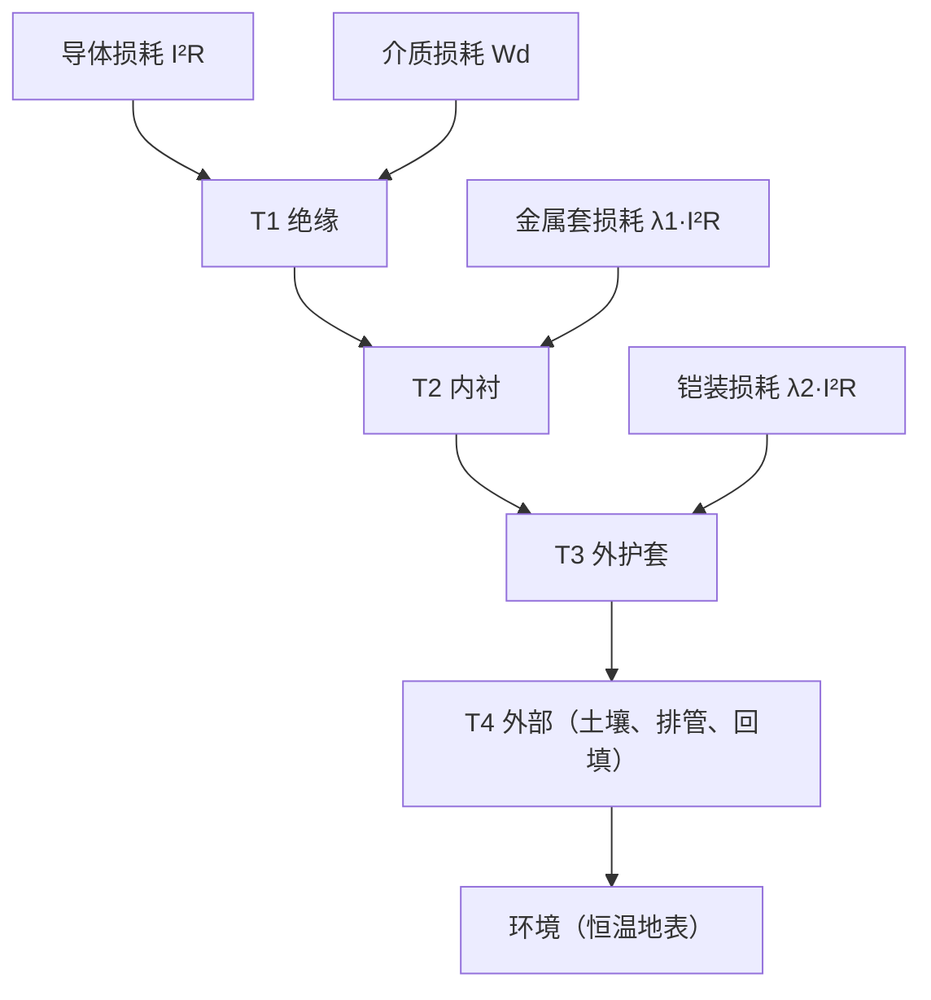

import PluginMethods from '../../../components/PluginMethods.astro';

插件 `cablesim.iec60287` 按 IEC 60287-1-1:2023（损耗）和 IEC 60287-2-1:2023（热阻）计算地下电缆在稳态下的导体温度和允许电流，并输出逐项损耗、热阻和互热，便于逐项核对。

## 原理

在给定敷设条件下，导体温度刚好达到允许最高温度时的电流就是载流量。IEC 60287 把电缆和周围介质看成一串热阻，各处损耗沿热路逐段产生温升：

$$
I = \left[\frac{\Delta\theta - W_d\left[0.5\,T_1 + n\,(T_2 + T_3 + T_4)\right]}{R\,T_1 + n\,R\,(1+\lambda_1)\,T_2 + n\,R\,(1+\lambda_1+\lambda_2)\,(T_3 + T_4)}\right]^{0.5}
$$

| 符号 | 含义 | 单位 |
| --- | --- | --- |
| $\Delta\theta$ | 导体允许温度与环境温度之差 | K |
| $R$ | 最高工作温度下的单位长度交流电阻（公式按 SI 取 Ω/m，界面显示为 Ω/km） | Ω/m |
| $W_d$ | 单位长度介质损耗 | W/m |
| $T_1, T_2, T_3$ | 绝缘、内衬、外护套的热阻 | K·m/W |
| $T_4$ | 电缆外部（土壤、排管、回填）的热阻 | K·m/W |
| $n$ | 电缆中承载电流的导体数 | — |
| $\lambda_1, \lambda_2$ | 金属套、铠装损耗与导体损耗之比 | — |

各项损耗从产生的位置开始，依次流过外层热阻散到环境：

直埋单根电缆的外部热阻：

$$
T_4 = \frac{\rho_T}{2\pi}\,\ln\!\left(u + \sqrt{u^2 - 1}\right), \qquad u = \frac{2L}{D_e}
$$

其中 $\rho_T$ 为土壤热阻率（K·m/W），$L$ 为电缆中心埋深，$D_e$ 为电缆外径。多根电缆之间的互热按镜像法叠加：第 $p$ 根电缆因其他电缆 $k$ 产生的温升为

$$
\Delta\theta_p = \frac{\rho_T}{2\pi} \sum_{k \ne p} W_k \,\ln\frac{d'_{pk}}{d_{pk}}
$$

$d_{pk}$ 为两缆中心距离，$d'_{pk}$ 为电缆 $p$ 到电缆 $k$ 关于地表的镜像的距离，$W_k$ 为电缆 $k$ 的实际总损耗（导体、金属套和介质损耗之和），不使用平均负荷。电阻随温度变化，温度与损耗迭代至收敛。

## 公式来源

采用 IEC 60287-1-1:2023 与 IEC 60287-2-1:2023（第 3.0 版）；交叉热源降额采用 IEC 60287-3-3:2007。软件和本文档都不包含标准原文，逐式核对依据受控原文进行。

| 计算项 | 条款 |
| --- | --- |
| 载流量方程；介质损耗经过 ½T₁ 的内部热路 | IEC 60287-1-1:2023 §4.2.1 式 (1) |
| 导体直流电阻、集肤效应与邻近效应、交流电阻 | IEC 60287-1-1:2023 §5.1.2、§5.1.3、§5.1.5.1 |
| 电容与介质损耗；XLPE 的 εr、tanδ 按额定电压档取值 | IEC 60287-1-1:2023 §5.2、表 3 |
| 单芯金属套环流损耗：品字形；水平换位与未换位 | IEC 60287-1-1:2023 §5.3.2；§5.3.3、§5.3.4 式 (8)–(10) |
| 未换位水平排列的金属套涡流损耗 | IEC 60287-1-1:2023 §5.3.7.1(2) |
| 三芯电缆各芯屏蔽损耗 | IEC 60287-1-1:2023 §5.3.11 |
| 磁性钢带、钢丝铠装损耗 | IEC 60287-1-1:2023 §5.4.3.3–§5.4.3.5（钢带为式 (17)–(20)） |
| 绝缘、内衬（填充）、外护套热阻 T₁、T₂、T₃ | IEC 60287-2-1:2023 §4.1.2–§4.1.5；三芯填充与内衬按 §4.1.4.2、§5.6 图 6 |
| 直埋电缆外部热阻 T₄ 与镜像互热 | IEC 60287-2-1:2023 §4.2.2、§4.2.3.2 |
| 接触品字形等效组 | IEC 60287-2-1:2023 §4.2.4.3.2 |
| 排管：管内空气、管壁、管外土壤三段热阻 | IEC 60287-2-1:2023 §4.2.6.3–§4.2.6.5、表 5 |
| 矩形回填或包封 | IEC 60287-2-1:2023 §4.2.7、表 2（只在表内双线性插值） |
| 交叉热源降额 | IEC 60287-3-3:2007 §4.1 式 (1)、§4.2 式 (2)–(13)、§4.3 式 (14)–(16) |
| 应急额定（给定有来源的阶跃响应） | IEC 60853-2 |

IEC 60287-2-1:2023 已停用 T₄ 的 ln(2u) 近似，工程计算使用上面的精确式。各条款的中间量、原文页码和核对表见[IEC 60287 逐项依据与算例](../notes/iec-60287/)。

## 适用范围

| 项目 | 覆盖 | 不覆盖 |
| --- | --- | --- |
| 电缆 | 同心单芯圆绞导体，光滑金属套，或给出波深、节距与间隙有效热阻率及来源的皱纹金属套；圆导体、各芯独立铜带或光滑金属屏蔽的三芯电缆（磁性钢带厚 0.3–1.0 mm；钢丝铠装时导体截面不超过 400 mm²） | 四芯等其他芯数；分割、扇形导体；复合护套；三芯非磁性铠装、混合填料、分离芯和单点接地 |
| 敷设 | 地下直埋，任意多根互不接触的电缆或管道；单回路接触品字形（按标准等效组）；每根一管的同心排管，电缆外径 25–100 mm；包含全部电缆的单个矩形回填或包封区 | 其他接触组合；多缆共管、偏心；空气与隧道 |
| 土壤 | 均匀原土，地表恒温，埋深不超过 10 m | 分层土壤、多种介质分区、土壤干燥区 |
| 电损耗 | 完整平衡三相单回路（品字形或水平）和已验证的双回平排分支自动计算 | 其他单芯多回路、任意排列或不平衡相电流须给出外部损耗系数及来源 |
| 接地 | 两端接地；品字形与未换位水平单点接地的涡流；水平定期换位的环流 | 交叉互联不自动计算 |
| 负荷 | 稳态 | 时变、周期、暂态负荷 |

同一插件还提供交叉热源降额（一根三芯直埋电缆，或同埋深、互不接触、负荷平衡的平行单芯单回路；热源与电缆的交叉位置重合）、IEC 60853 应急额定（热独立回路，给定有来源的阶跃响应）和 CIGRE TB 880 参考链。

## 超出范围时

插件不外推、不钳制、不换用近似公式，也不用默认值补缺项：

- 缺项和输入错误由运行前预检列出，预检对话框显示“有 N 项需要修正”或“有 N 项超出范围”，并逐条指出字段，不能运行。
- 运行中才能判断的超范围（例如回填几何比超出表 2）由插件拒绝计算：研究显示“失败”，运行记录保存原因代码、说明和对应输入字段的位置，不给出允许电流。
- 多回路中，若其他回路的保存负荷已使某回路在零电流时超温，该回路的允许电流显示“在其他回路当前负荷下没有正允许电流”，真实的运行超温结果保留。
- 每次运行都有独立核算（见下文）；核算不闭合时不生成可用结果。

常见的拒绝原因：

| 原因代码或提示 | 情况 | 处理 |
| --- | --- | --- |
| `SOIL_LAYERS_NOT_SUPPORTED` | 敷设截面使用了分层土壤 | 改用[有限元](../fem/)温度场 |
| `BACKFILL_GEOMETRY_OUT_OF_RANGE` | 回填几何比超出 IEC 60287-2-1:2023 表 2 | 改用有限元温度场 |
| `BACKFILL_CORRECTION_INVALID` | 回填修正产生负热阻 | 改用有限元温度场 |
| `T4_APPROXIMATION_SUPERSEDED` | 方法参数选择了已停用的 ln(2u) 近似 | 在方法参数中把“外部热阻公式”改为精确式 |
| `DOUBLE_FLAT_TABLE_RANGE` | 双回平排的系数超出来源表 | 用 GetDP 涡流仿真求护套损耗，再作为外部系数带入 |
| `CROSSING_SCOPE` | 交叉热源与排管、回填或分层同时存在，或三芯分支不止一根电缆 | 建立包含热源实际几何的三维热仿真 |
| `CROSSING_TOUCHING_GROUP` | 对接触电缆组（含接触品字形）套用交叉降额 | 同上；本次不输出降额值 |
| `CROSSING_GROUP_SCOPE`、`CROSSING_UNBALANCED_GROUP` | 不同埋深、多回路或负荷不平衡的单芯组套用交叉降额 | 同上 |
| “IEC 60287 插件当前不覆盖四芯或其他非单芯、三芯结构。……” | 四芯等结构 | 可改用 [GB 50217 校正](../gb-50217/)，须提供同型号、条件明确且有来源的基准载流量 |
| “此 IEC 方法支持地下稳态；空气、隧道和时变负荷请使用对应方法。” | 空气、隧道或时变负荷 | 选择覆盖该工况的方法 |

## 输入要求

| 输入 | 单位 | 来源要求 |
| --- | --- | --- |
| 各层尺寸与材料 | mm | 来自引用的型号版本，逐项带来源 |
| 导体 20 °C 直流电阻 R₂₀ | Ω/km | 厂家资料或标准依据 |
| 绝缘相对介电常数 εr、介质损耗因数 tanδ | — | IEC 60287-1-1:2023 表 3 或实测；XLPE 在 18/30 kV 及以下为 2.5 和 0.004，更高电压档 tanδ 为 0.001 |
| 集肤、邻近效应构造系数 ks、kp | — | 方法参数中显式填写并写明出处 |
| 中心埋深、排列与间距 | m | 敷设截面 |
| 排管与回填的几何和材料；排管热阻常数 U、V、Y | — | 敷设截面与方法参数，常数取 IEC 60287-2-1:2023 表 5 |
| 金属套接地方式 | — | 工况；不从未知方案推断 |
| 地表温度 | °C | 工况环境 |
| 土壤或回填热阻率 | K·m/W | 工况环境与材料 |
| 导体允许温度 | °C | 设计准则 |

皱纹铝护套还需要声明间隙的有效热阻率及其来源，软件不会自动套用缓冲带或空气的数值。缺少任何必需输入时，运行前预检会指出缺哪一项。

## 验证算例

| 算例 | 内容 | 核对方式与结果 |
| --- | --- | --- |
| CIGRE TB 880:2022 算例 0-1、0-2、0-3 的 9 个变体 | 直埋（精确与简化根式）、平排排管、回填排管、单点接地、GP31 涡流 | 与原文的中间量和最终电流逐项核对 |
| TB 880 算例 1（原文第 131–163 页） | 铜丝屏蔽与铝箔并联：接触三叶形；平排不换位、不平衡交叉互联 | 插件结果 990.54 A 和 1460.45 A，与原文数值核对 |
| TB 880 算例 2（第 164–179 页） | 三芯铅护套、钢丝铠装 | 插件结果 838.34 A，与原文数值核对 |
| TB 880 算例 4（第 195–205 页） | 接触三叶形、低覆盖率铜线屏蔽 | 插件结果 537.46 A，与原文数值核对 |
| TB 880 算例 10 | 钢带等效厚度与铠装损耗的两个分量 | 组件核对 |
| IEC 60287-3-3:2007 附录 A | 300 mm² 单芯平排电缆与 132 kV 三芯电缆垂直交叉 | 中间量 TL、Tr、T 与原文出版精度一致；最终温升约 14.11 K（原文 14.1 K）；降额系数精算约 0.885，原文印刷值 0.89，未取得官方勘误，不放宽容差 |
| IEC 60853-2 AMD1:2008 附录 F.6.2 | 应急额定 | 参考电流 1550 A 时的六小时应急电流 2131 A |
| IEC 60287-2-1:2023 解析核对 | 两根电缆及多热源不等负荷的镜像法；表 2 的节点、插值与非均匀回填修正 | 与闭式解析解核对 |
| 九种单芯敷设模板 | 单回接触品字形、单回水平、双回品字形、双回水平、品字形排管、2×3 排管、3×3 排管、矩形回填、3×3 包封排管 | 独立对数热平衡与冻结损耗二次方程核对 |
| 三芯逐芯屏蔽 | 六种直埋与排管工况 | 分项热阻、损耗与二次方程手算一致 |

每次运行另存一份核算：用独立的对数式重建自热、镜像热阻和内部热路，代入最终损耗核对每根电缆的温度（容差 1×10⁻⁴ K），并用最终的交流电阻、损耗比等参数手算允许电流（容差 0.001 A）。计算书列出插件值、手算值、差值、单位、容差和条款。这项核算验证热路与最终状态闭合，不是独立的电磁复算、标准认证或现场试验。

验证夹具来自受控资料，不随公开仓库分发。与厂家样本的交叉比较（结构参数不完全相同，只作参考）见[逐项依据与算例](../notes/iec-60287/#三芯直埋与-xlpe-介质损耗核验)。

## 已知限制

- 平台不做跨回路电磁求解；单芯多回路、任意排列或不平衡负荷须给出外部损耗系数及来源。
- “其他回路固定负荷下的条件上限”逐回路成立，各回路的上限不能同时使用；需要全部回路同时运行时看“全回路共同能力”。
- 皱纹金属套按平均直径模型计算，局部接触、脱离间隙和放电热点不在范围内。
- 交叉热源降额不覆盖两条电缆联合重定额、交叉点错开以及给定电流下的三维温度。
- 选择 TB 880 历史参考口径时只复现原算例的约定，结果标为参考复现，不能作为 IEC 2023 工程结论。
- 快速土壤温度图采用镜像线热源叠加，只用于均匀土壤；回填、分层和接触等效组不出图，也不替代有限元。
- 验证只覆盖所列算例与分支，不构成合规认证。

## 插件清单

以下为 `steady-rating` 能力的清单内容；应急额定、TB 880 参考链、三芯工程参数推导等其他能力见[方法清单](../catalog/)。

<PluginMethods id="cablesim.iec60287" only={['steady-rating']} />
