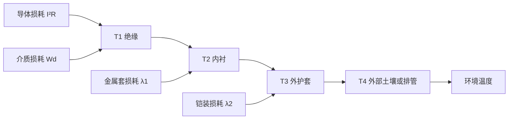

import PluginMethods from '../../../components/PluginMethods.astro';

## 原理

在给定敷设条件下，导体温度达到允许最高温度时的电流即为载流量。IEC 60287-1-1 把电缆与周围介质看成一串热阻，损耗沿热路逐段产生温升：

$$
I = \left[\frac{\Delta\theta - W_d\left[0.5\,T_1 + n\,(T_2 + T_3 + T_4)\right]}{R\,T_1 + n\,R\,(1+\lambda_1)\,T_2 + n\,R\,(1+\lambda_1+\lambda_2)(T_3 + T_4)}\right]^{0.5}
$$

式中 $\Delta\theta$ 为导体允许温升（K），$R$ 为最高工作温度下单位长度交流电阻（Ω/m），$W_d$ 为介质损耗（W/m），$T_1 \ldots T_4$ 分别为绝缘、内衬、外护套和外部热阻（K·m/W），$n$ 为电缆芯数，$\lambda_1$、$\lambda_2$ 为金属套和铠装损耗系数。

## 验证与适用范围

<PluginMethods id="cablesim.iec60287" only={['steady-rating']} />
