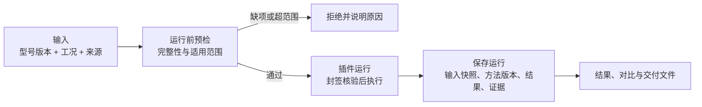

import { CardGrid, LinkCard } from '@astrojs/starlight/components';

CableSimPro 的宿主只提供工程底座（工程与版本、运行快照、来源追溯、结果工件、交付和审批），**不内置任何算法**。每种计算方法都是一个插件，在清单里声明：

- 计算能力、方法版本和适用的研究任务；
- 输入要求（参数、单位、范围、必填项）和输出；
- 适用范围与已知限制；
- 验证等级与验证用例；
- 求解位置（本机、超算或两者均可）。

插件清单与源码由封签（逐文件 SHA256）绑定。宿主每次调用方法前都会重新核对封签，不一致就拒绝运行。

## 一次计算是怎样进行的

每次运行都保存输入快照（SI 单位）、所用方法和插件的版本、结果工件以及核验证据；之后输入变化只会让结果标为“过期”，不会改写历史运行。

## 验证等级

| 等级 | 含义 |
| --- | --- |
| 解析基准核对 | 与独立的解析解或手算逐项核对。 |
| 参考算例核对 | 与公开算例（如 CIGRE TB 880）、标准附录、文献或商业软件的保存结果核对。 |
| 接口测试 | 验证了输入输出契约和拒绝规则，数值本身另有出处。 |
| 未经独立验证 | 仅作参考研究使用，结果不能单独作为工程依据。 |

验证只说明列明范围内的对拍结果，不代表未覆盖的工况也已验证。已复现的公开算例、文献案例和解析基准在软件的“方法 → 验证算例”中查看，并列出与原文的最大相对偏差。

## 结果口径

多回路时，允许电流区分“单回路能力”“全回路共同能力”和“其他回路固定负荷下的条件上限”，结果里写明是哪一种，不能混用。详见[载流量研究 · 读结论](../guide/ampacity-study/#6-读结论)。

## 方法

<CardGrid>
  <LinkCard title="IEC 60287 稳态载流量" href="iec-60287/" description="地下电缆稳态温度与允许电流，多回路直埋、排管与矩形回填" />
  <LinkCard title="GB 50217 载流量校正" href="gb-50217/" description="把有出处的单根基准载流量按附录 D 换算到实际工况" />
  <LinkCard title="热网络交叉校核" href="thermal-network/" description="可审计的简化稳态热网络，用于同输入方法对比" />
  <LinkCard title="有限元对照" href="fem/" description="有限元温度场、暂态、护套损耗与电热耦合，以及与 IEC 的对照" />
  <LinkCard title="标准核对" href="standard-check/" description="按已核验的 GB 产品标准核对结构尺寸与导体电阻" />
  <LinkCard title="方法清单" href="catalog/" description="全部插件、能力、验证等级与求解位置" />
</CardGrid>

各方法的逐项依据、算例与核对表见侧栏“技术说明”。
